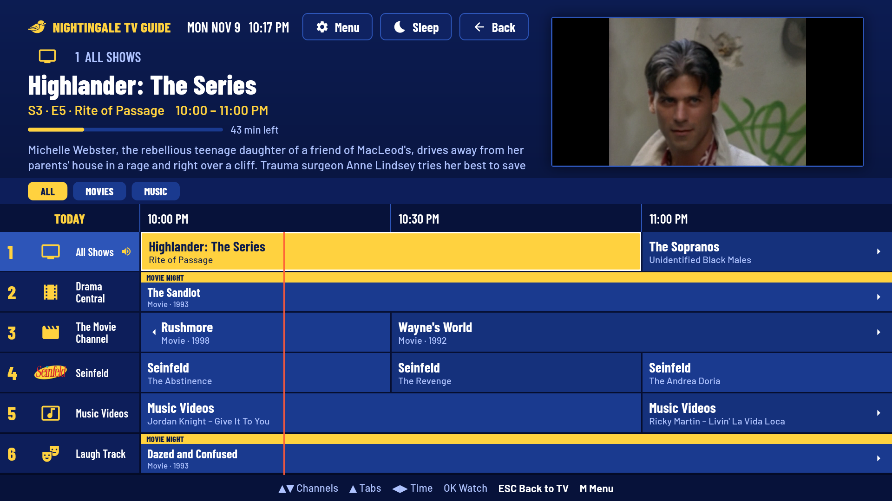
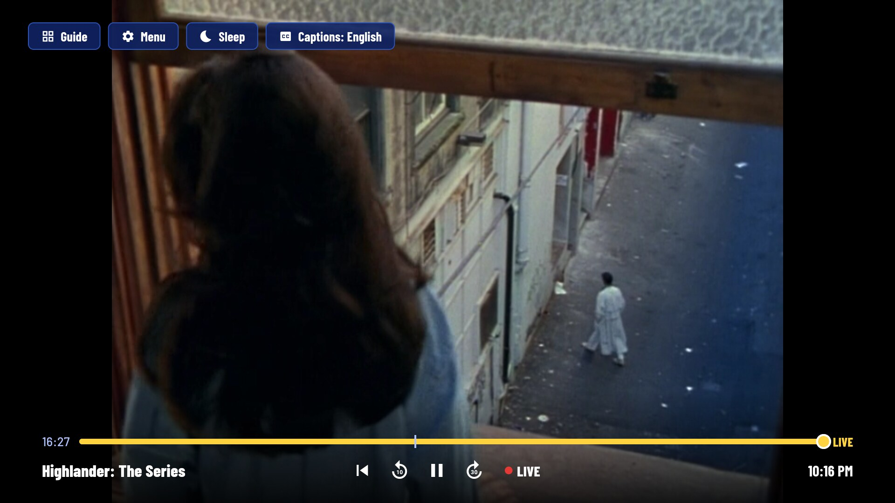
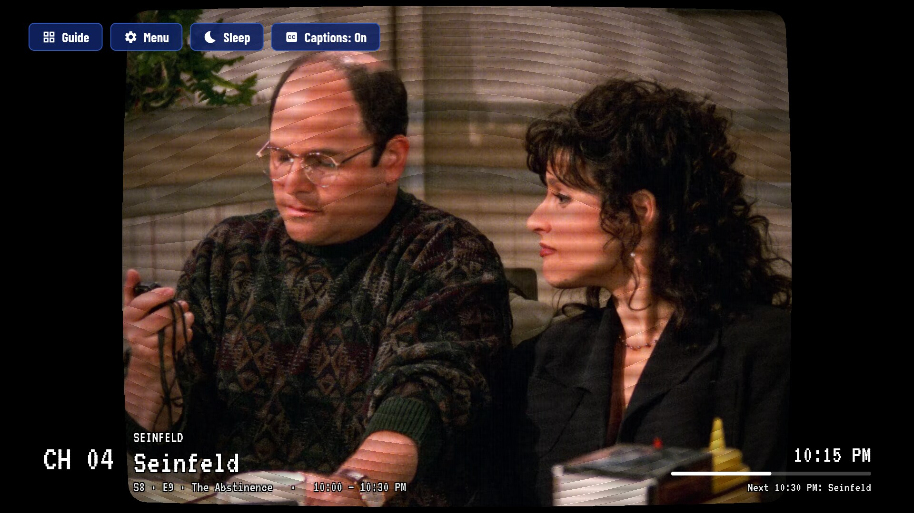
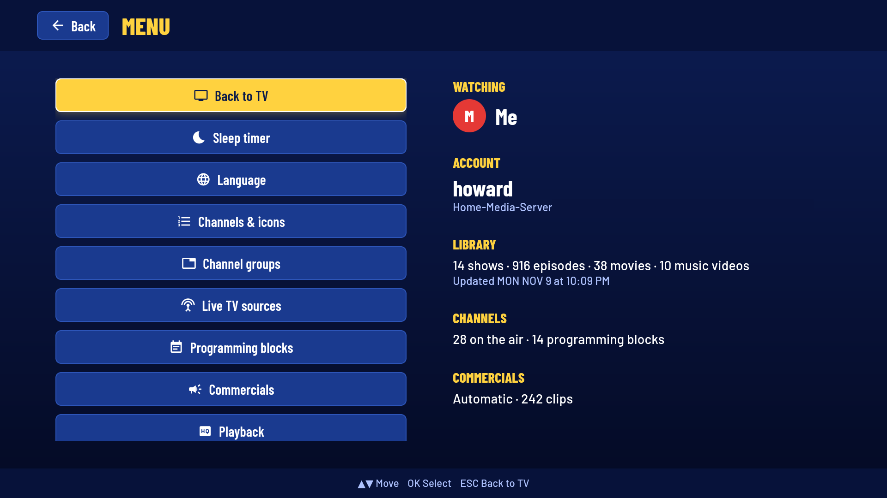
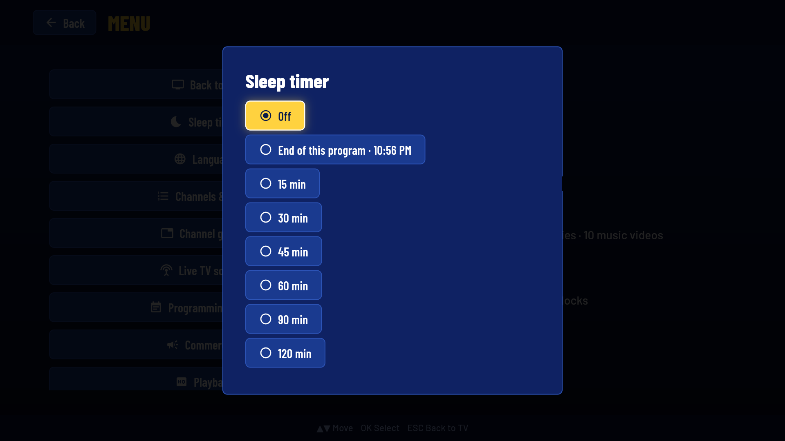
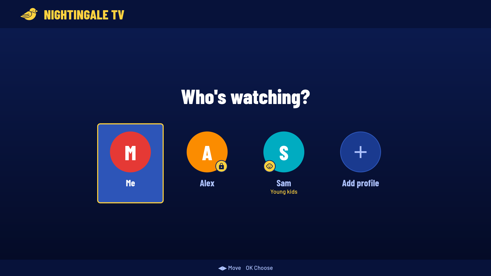
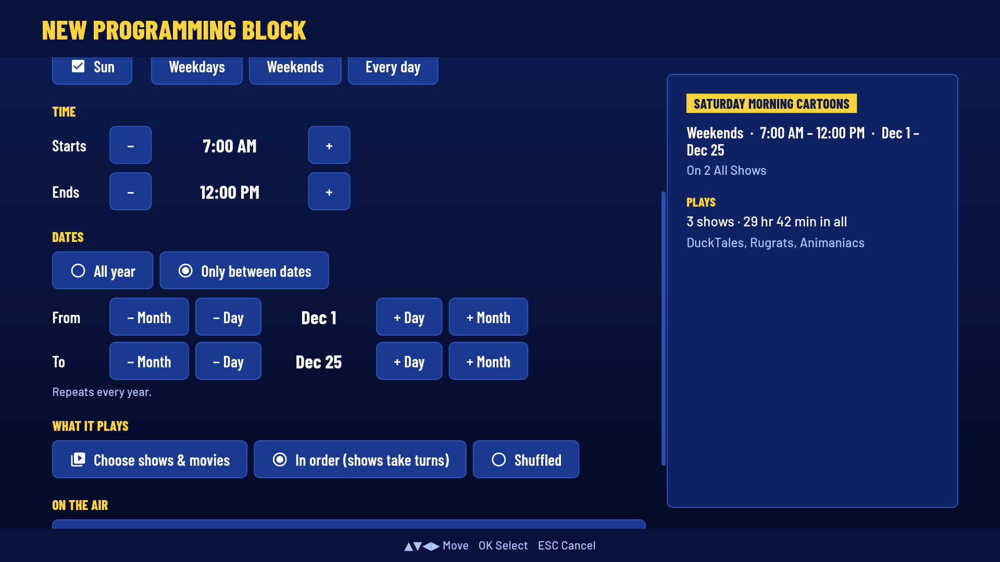
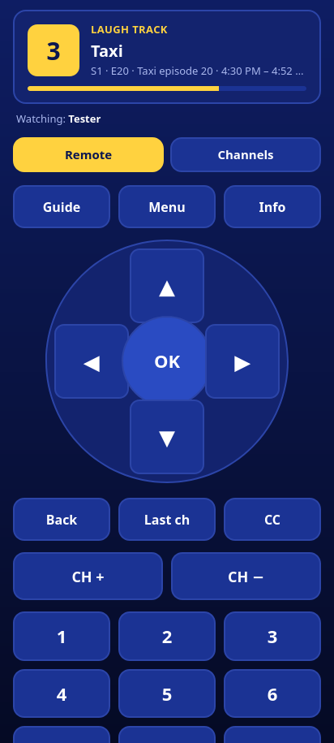

# Nightingale TV

Nightingale TV turns your Jellyfin, Emby or Plex library into always-on cable TV channels, plus music video and radio channels, with a program guide. It's an Android app first, made for Android TV (Google TV and other Android TV boxes) and also at home on Android phones and tablets. There's a desktop version for Linux too, and a macOS version is planned. Like real TV, every channel is always mid-broadcast. You tune in to whatever is on, flip channels, and check the guide to see what's coming up.

It's built for the couch, so everything works with a TV remote, an air mouse, a touchscreen, your phone, or a keyboard and mouse.



## Features

### Channels

- **Channels made for you.** The app builds a lineup from your library: an all-shows channel, genre channels for shows and movies (comedy, kids, sci-fi…), decade channels ("90s TV", "80s Movies") and pairs of the two ("80s Action Movies"), marathon channels for your biggest shows, and movie channels. Show genre channels run like cable: a **Daytime** stack of shows at the same times every day from 6 AM to 6 PM, and an **Evening** block of the genre's movies until midnight when there are enough of them. Rename, renumber, hide or favorite any channel, and give it a built-in icon, a station badge, a show logo or your own image.
- **Build your own channels.** In Channels & icons → **New channel**, mix collections, folders, shows, seasons, genres and movies into a channel of your own, such as "80s Sitcoms" or "Saturday Night Movies". Play them **In order**, **Shuffled** or **Least watched first**. Channels you build are kept when you reset the lineup.
- **Programs that start on the clock.** Give any channel a **slot length** (15 minutes to 2 hours) so every program starts on time. Fill the rest of each slot with clips from a commercial pool or an offline image of your own, or choose **Truncate** to end programs that run long.
- **Always on the air.** Channels run on the clock, so you join a show mid-episode, just like flipping to it on cable.
- **Programming blocks.** Set up lineups such as "Saturday Morning Cartoons" on chosen days and times, or only during a date range each year ("Christmas Specials, Dec 1–25"). A block plays a mix of shows, movies, collections and folders, or a lineup you program slot by slot (DuckTales, then two Animaniacs, then Rugrats). Each airing picks up where the last one left off.
- **Late-night blocks.** A block can play only what's rated at or above a minimum rating, so a channel can drift into mature programming late at night. **New late-night block** sets one up in a step: "Late Night", every day from 11 PM to 4 AM, TV-MA and up. Blocks can follow one another (TV-14 and up at 9, TV-MA and up at 11). Kid profiles never get them.
- **New episode premieres.** Episodes newly added to your server premiere in prime time (8:00 PM by default) on a channel that plays the show, one new episode per show each night, marked **NEW** in the guide, the banner and the Up next card. Change the time and days or turn it off in Programming blocks → **New episode premieres**.
- **Music channels.** Music libraries and music videos get their own channels: **Music Videos** and **Music Radio**, plus genre and decade channels when your library is big enough ("80s Radio", "Rock Music Videos"). Songs play over a full-screen **Now Playing** card with the album art, song, artist and album. The same artist never plays twice in a row, music channels have no commercial breaks unless you turn them on, and music never shows up in your server's play history.
- **Live TV channels.** Add real broadcasts and IPTV to the lineup in Menu → **Live TV sources**: your Jellyfin, Emby or Plex server's Live TV (an HDHomeRun or other tuner on the server), or any **M3U playlist** with an **XMLTV guide**, from a web address or a file. Pick the channels you want, and they join the guide with their own logos and listings, numbered from the next hundred (100, 101…). Live channels play from the live point, reconnect after a drop, and have no commercial breaks. Kid profiles don't get them.

### The guide

- **Program guide.** A scrolling cable-style grid with a live preview window, programming blocks labeled across their time slots, and an "Up next" card near the end of each show. It reaches 8 hours ahead, or 3 or 5 (**Guide range** in Channels & icons).
- **Guide tabs and channel groups.** Tabs at the top of the guide show **All**, **Favorites**, **Movies**, **Music** and **Kids** channels, plus groups you make yourself in Menu → **Channel groups**. Channel up and down still go through every channel, and exported M3U playlists use your groups as categories.
- **A phone layout.** Held upright, a phone shows the picture on top, what's on now and next below it, and a scrolling channel list under the tabs. **Full screen** turns it sideways into the TV layout.

### Watching

- **Pause and rewind.** Pause what's on, skip back 10 seconds or forward 30, **Restart** the program, or go back to **Live**, from the transport bar (◀ or ▶ while watching) or the remote's Play/Pause, Rewind and Fast-forward buttons. You can go back to the start of the program on now, or 30 minutes, whichever is earlier. Nothing is recorded: the channel's schedule is simply played a little later for you. Turn it off in Menu → **Playback** to keep every channel on the clock. Live channels can't be paused.
- **Sleep timer.** Stop playback after 15 minutes to 2 hours, or at the end of the program on now, and let the TV sleep. Press S, or choose **Sleep timer** in the menu.
- **Are you still watching?** After 4 hours with no button pressed, the app asks, and stops playback if nobody answers within a minute, so your server stops streaming. Change it to 2 or 8 hours, or turn it off, in Menu → **Playback**.
- **Captions.** Pick a subtitle track with the **Captions** button or the remote's Captions key, in four sizes (Small to Extra large, in the Captions list or Menu → **Playback**). See [Captions](#captions).
- **On-screen clock.** Shows the time in the corner of the picture (off by default, in Menu → **Playback**).
- **Volume leveling.** Evens out the volume as you watch, so loud commercials and quiet shows come out about the same (off by default, in Menu → **Playback**). On Android, surround audio is decoded on the device while it's on, instead of passed through to a receiver.
- **Channel logo in the corner.** A translucent station logo sits in the bottom-right corner of the picture, like a network's. Show it **Always**, **Now and then** (for 20 seconds when a show starts or comes back from a break, and at each quarter hour) or **Off**, for every channel or for one.
- **Retro look.** Make a channel look like an old TV in Menu → **Retro look**: a **4:3 picture** (filled or fitted) with a black, charcoal, channel-colored or picture surround, a **CRT effect** (Soft tube, Living room, Arcade, Studio monitor, or your own mix of scanlines, glow, curvature and color), and an **overlay theme** for the banner and channel number (Standard, VCR, Cable box, Station ident). Set it for every channel and override it for any one. **Effects on this device** turns the CRT effects off on a slower TV without changing anything else. Exported streams are never changed.

  **On NVIDIA Shield, curvature and glow aren't available** (Retro look shows them as "Not available on this device"). The Shield's graphics driver shows video with the wrong colours under Flutter's newer renderer (Impeller), so on NVIDIA devices the app draws with the older renderer (Skia) instead. Curvature and glow are a GPU shader filter that only Impeller can run. Scanlines, mask, vignette and color all work on the Shield.
- **Quick channel changes.** The app keeps its connections to your server ready, remembers how each file plays, and loads the next part of a channel before it's due, so channels come up fast and breaks play in and out with no gap.
- **Always direct play.** Nightingale TV plays your original files and never asks your server to transcode, unless you turn on **Transcode only if needed**. Then pick a **maximum bitrate** (40 Mbps · 4K down to 4 Mbps · 720p) for Wi-Fi or a remote connection, and your server converts only what's above it. *Original*, the default, never converts because of bitrate.

### Commercial breaks (experimental, off by default)

Make TV feel like TV again, with ads between and during shows. Being experimental, this may change between versions. The rest of the app works the same with breaks off.

- **Your own ads.** Pick the folders or collections on your server that hold your commercials. Their videos leave your regular channels and fill the breaks instead.
- **Bumpers around the ads.** Set a pool's type to **Bumpers** and its station idents open and close the breaks. A Custom plan can pick its own bumper pool or turn them off, so a channel can have its own idents.
- **Ad compilations split automatically.** Long compilations (an hour of '80s ads in one file, say) are cut into individual ads at their chapters, or, on a computer, where the picture goes black and silent.
- **Breaks where they belong.** Ads play before, during and after shows and movies. Mid-show breaks go at act breaks when the show's chapters mark them, and otherwise at a scene change near evenly spaced points.
- **Automatic or Custom.** **Automatic** lays breaks out broadcast-style, fitting the ads so shows start on the hour and half hour, with no break longer than 5 minutes. **Custom** sets how long each break is, how often shows break and which ads each break uses, for every channel or for one.
- **Break notices.** A small countdown says when a break is about to start and when the program is coming back (on by default, in Menu → **Playback**).
- **Same ads for everyone.** Like real TV, tuning away and back shows the same ads at the same spot. Ads never show up in your server's watch history.

### Your household

- **Six languages.** English, Deutsch, Français, Español, Português (Brasil) and Italiano, set per profile under Menu → Language. Automatic follows the device. The web admin follows the browser and has its own Language menu.
- **Jellyfin, Emby and Plex.** Sign in to any of them. Every feature works on all three. The one exception: a Plex server that doesn't list its artists' music videos gets no music video channels.
- **Several servers in one lineup.** Add more servers to a profile in Menu → **Servers**, in any mix (Jellyfin at home and a friend's Plex, say). Their libraries become one, and something on two servers appears once and plays from the first in your **Play from** order that answers. Give a slow remote server its own **Quality limit**. If one server is down, the others keep playing.
- **Profiles.** Everyone gets their own channels, blocks and settings. Kid profiles only see content rated for their age. Grown-up profiles and settings can be locked with a PIN.
- **Phone remote.** Turn it on in the menu, scan the QR code, and your phone's browser becomes the remote. There's nothing to install. See [Phone remote](#phone-remote).
- **Backup and restore.** Your whole setup is backed up every day something changes, and before anything that replaces a lot at once. Restore a backup, save it to a file, or move it to another device through your phone or computer. See [Backup and restore](#backup-and-restore).

### Watch on your other screens

- **Live TV export (desktop).** Your channels play in Jellyfin Live TV, Plex, Emby or any IPTV app on your home network, with the same schedule, breaks and ads as this TV. Each profile you export shows up as its own **HDHomeRun tuner**, with an **M3U playlist** and a three-day **XMLTV guide**. See [Live TV export](#live-tv-export).
- **Nightingale TV server (Docker).** Run your channels on an always-on machine such as a NAS instead of a desktop that has to stay open, and set everything up from a browser in its **web admin**: profiles, channels, blocks, commercials, Live TV sources, export, backups and user accounts. See [Running it as a server](#running-it-as-a-server).

| Watching, with captions and pause and rewind | Retro look: Living room CRT and VCR overlay | Menu |
| --- | --- | --- |
|  |  |  |

| Sleep timer | Who's watching? | Programming block editor | Phone remote |
| --- | --- | --- | --- |
|  |  |  |  |

## Install

Nightingale TV is free and open source. On Android there are three ways to get it, all built from the same source code:

- **Buy it from the store** (coming soon). It will be sold on **Google Play** for Android TV, Google TV, phones and tablets, and updates by itself. Buying it is the easy way to get Nightingale TV, and it supports the project.
- **Download it for free** from [Releases](https://github.com/tcaplette/Nightingale-TV/releases). The official APKs are the same app as the store version, signed with the same key, but they don't update by themselves. See [On Android](#on-android).
- **Build it yourself, for free.** See [Building from source](#building-from-source).

The desktop version (Linux) is free on [Releases](https://github.com/tcaplette/Nightingale-TV/releases), or you can build it yourself. See [On a computer](#on-a-computer).

### On Android

One app covers Android TVs, phones and tablets (Android 7.0 or newer). Each release has four APKs. Install the one for your device:

| APK | For |
| --- | --- |
| `nightingale-tv_<version>_arm64-v8a.apk` | Most TVs, TV boxes and phones from the last several years (Google TV, NVIDIA Shield, Pixel, Galaxy…) |
| `nightingale-tv_<version>_armeabi-v7a.apk` | Older or cheaper TV sticks and boxes (many no-name boxes) |
| `nightingale-tv_<version>_universal.apk` | Any of them, if you're not sure. It's several times larger. |
| `nightingale-tv_<version>_x86_64.apk` | Android Studio emulators on a PC |

`<version>` is the release's version and build number, such as `1.2.4+5006`.

On a phone or tablet, open the APK on the device and allow *Install unknown apps* when asked. On a TV, turn on *Developer options* and *USB debugging* (or *Network debugging*), then run `adb install nightingale-tv_<version>_arm64-v8a.apk` from your computer, or copy the APK over with a file manager app and open it there. To update, install the next release's APK over the old one; your profiles stay.

On Android the app fills the screen and keeps it on while it's in front. On a phone held upright it uses the [phone layout](#the-guide). Going to the home screen stops playback, and coming back tunes in to the same channel live.

#### Store version, official APKs and your own build

- **The store version and the official APKs are the same app**, **Nightingale TV**. Each installs over the other and keeps every profile, channel and setting.
- **Your own build is a separate app**, **Nightingale TV (own build)**. It installs beside the store version with its own profiles, channels and settings. The **About this install** section of **Backup & restore** says which one you're in.
- **Moving your setup across:** in **Backup & restore**, pick **Move my setup to …** (or **Bring my setup here from …**). The other app opens and asks before restoring. It works with just a remote. A backup file works too (see [Moving to a new device](#moving-to-a-new-device)).
- **Don't uninstall first.** Uninstalling either app deletes its setup unless you've moved it or saved a backup file.

### On a computer

The desktop version runs on 64-bit (x86-64) Linux. Each release has two downloads:

| Download | For |
| --- | --- |
| `nightingale-tv_<version>.<build time>_amd64.deb` | Ubuntu 24.04 or newer, Debian 13 or newer, and distributions based on them (Linux Mint 22, Pop!_OS 24.04…) |
| `nightingale-tv-linux-x64-<x.y.z>.tar.gz` | Other distributions (Arch, Fedora, openSUSE…) from 2024 or newer |

For 1.2.4 these are `nightingale-tv_1.2.4+5006.20261110045935_amd64.deb` and `nightingale-tv-linux-x64-1.2.4.tar.gz`.

**The .deb:** in the folder it's in, run `sudo apt install ./nightingale-tv_*_amd64.deb` (the `./` matters: without it apt looks online). apt also installs the libraries Nightingale TV needs, ffmpeg included. Then open **Nightingale TV** from your app menu, or run `nightingale-tv`. To update, install the next release's `.deb` the same way; your profiles and settings stay. It needs Ubuntu 24.04 or newer because it uses libmpv version 2, and Ubuntu 22.04 only has version 1. On 22.04, build it yourself.

**The .tar.gz:** first install GTK 3, libmpv 2 (`libmpv.so.2`), OpenGL ES (Mesa) and ffmpeg from your distribution (on Arch: `sudo pacman -S gtk3 mpv mesa ffmpeg`). Unpack it anywhere and run `./nightingale_tv` in that folder. To update, unpack the next release over it.

**Building it yourself** on Ubuntu or another Debian-based Linux: set up the tools in [Building for Linux](#building-for-linux), then run `tool/install.sh` in the project folder. It builds a package and installs it with `apt`, like the release `.deb`. To update, pull the latest code and run it again. `tool/build_deb.sh` only makes the package (`dist/nightingale-tv_*_amd64.deb`), to copy to a computer on the same or a newer release. To uninstall: `tool/install.sh --uninstall` or `sudo apt remove nightingale-tv`. Your settings in `~/.local/share/com.coffeehauslabs.nightingale_tv` are kept.

**Only in the desktop version:** **Live TV export**, which needs ffmpeg and a computer that stays on, and splitting ad compilations by picture and sound. On Android, compilations are split only at their chapters (or Jellyfin's media segments).

### What you need

- An Android TV or Google TV device, or an Android phone or tablet, running Android 7.0 or newer. Or, for the desktop version, a 64-bit Linux PC: Ubuntu 24.04 or newer for the release `.deb` (Ubuntu 22.04 if you build it yourself), or another distribution from 2024 or newer for the `.tar.gz`.
- A [Jellyfin](https://jellyfin.org) server (10.11 or newer), an [Emby](https://emby.media) server (4.8 or newer) or a [Plex Media Server](https://www.plex.tv) with your shows and movies, and music or music videos if you want music channels. You can add more than one.
- For the phone remote, a phone on the same Wi-Fi as the TV. See [Phone remote](#phone-remote) if the computer's firewall is on.
- On Linux, ffmpeg (the `.deb` installs it; with the `.tar.gz`, install it yourself). It splits long commercial compilations into individual ads and converts Live TV export's streams.

## First start

1. Enter your server's address. The app works out whether it's Jellyfin, Emby or Plex. For Plex you can also choose **Sign in with Plex** instead.
2. Sign in:
   - **Jellyfin or Emby:** with your username and password, or with **Quick Connect** when the server has it on, approving the TV from your phone.
   - **Plex:** go to plex.tv/link on your phone or computer and enter the code the TV shows. If the account can use more than one server, pick one, and in a Plex Home pick who's watching.
3. The app scans your library and builds your channels. That's it. It starts on channel 1.

To add another server to the same lineup later, use Menu → **Servers** → **Add a server**. It signs in the same way.

Moving from another device? Choose **Restore from a backup** on the sign-in screen. If the app finds a backup of its own when it starts with no profiles (after a reinstall, or from Android's backup), it shows **Welcome back** and offers to **Restore it**. See [Moving to a new device](#moving-to-a-new-device).

## Controls

| Remote button (keyboard) | Watching TV | In the guide |
| --- | --- | --- |
| ▲ ▼, Channel Up/Down (Page Up/Down) | Change channel | Move between channels (▲ from the top row reaches the guide tabs, then **Menu**) |
| ◀ ▶ | Open the pause and rewind controls (the banner on a live channel, or with Pause and rewind off) | Move through time (on the tab row, pick a tab) |
| Play/Pause (P), Play, Pause | Pause or resume | |
| Rewind, Fast-forward | Back 10 seconds, forward 30 (hold to go faster) | |
| Info (I) | Show the banner | |
| OK (Enter) | Open the guide (resume, while paused) | Watch that channel |
| Guide (G) | Open the guide | Back to TV |
| Back (Esc) | See below | Back to TV |
| 0–9 | Go to a channel number | |
| Last or Recall (Backspace, L) | Last channel | |
| Captions (C) | Captions on/off, in the language picked last | |
| (S) | Sleep timer | |
| Menu (M, right-click) | Menu | Menu |
| (F11) | Full screen on/off, on a computer | |

**Back** works as Esc does on every screen, except on the TV picture itself on Android: there it shows "Press Back again to exit", and a second Back within 3 seconds closes the app. On a computer, Esc on the TV picture opens the guide.

**With an air mouse:** move the pointer while watching, and **Guide** and **Menu** buttons appear in the top-left corner. In the guide, click a channel to watch it, click a tab to filter the channels, or click **Menu** at the top.

**On a phone or tablet:** tap where you'd click and long-press where you'd right-click (the TV picture or the guide opens the menu). Tapping the picture shows the pause and rewind controls, with the guide among them. Drag to scroll the guide and lists. The back gesture works as the Back button does.

### Captions

Press ◀ or ▶ to bring up the buttons, ▲ to reach them, then pick **Captions** (after **Sleep**). On a phone the **Captions** button sits beside **Menu** over the player. The list shows **Off** and every subtitle track of the program, in the file or beside it (`Movie.en.srt`), plus the caption size. Your pick is saved for the profile, so later programs on any channel show a track in the same language. On a live TV channel the choice is just **Off** or **On**.

## Phone remote

Menu → **Phone remote** turns it on, on Android TV and the desktop version. Scan the QR code with your phone's camera, or open the address shown and type the 6-digit code. The phone has to be on the same Wi-Fi as the TV, and the remote answers while Nightingale TV is open.

- **Pairing** works only while the Phone remote screen is open, and a paired phone works with that TV only. Up to 20 phones stay paired; the screen lists them, with **Remove** and **Remove all**.
- **Is it working?** The screen says **Working**, **Not confirmed yet**, or **Blocked** when a firewalld firewall stops phones, with the command to fix it.
- **If the phone can't connect,** check it isn't on a guest network or mobile data, and that the Wi-Fi doesn't keep devices apart ("AP isolation" or "client isolation").
- **Firewall on Linux** (only if ufw or firewalld is on). Android TV needs nothing. The `.deb` installs firewall profiles for the remote's ports (8642 to 8651) but never opens them. Allow them once:
  - ufw: `sudo ufw allow "Nightingale TV Remote"`
  - firewalld: `sudo firewall-cmd --permanent --add-service=nightingale-tv-remote && sudo firewall-cmd --reload`

  With the `.tar.gz`, allow the port the screen shows instead, usually `sudo ufw allow 8642/tcp`.
- The remote only works on your home network. Don't open a port for it on your router.

## Backup and restore

Menu → **Backup & restore** (grown-ups only, when there are kid profiles) lists every backup, newest first. Pick one to **Restore** it, **Save to file**, or **Delete** it, or make one with **Back up now**. The app also backs up every day something changes, and before anything that replaces a lot at once. It keeps the 14 newest daily backups and the 10 newest "Before…" ones; backups you make or bring in are kept until you delete them.

**A backup holds** every profile with its PIN and all its channels, groups, blocks, commercial settings and custom images, plus the Live TV export and phone remote settings.

**It never holds** server sign-ins or paired phones, so a backup file can't get anyone into your server. A restored profile asks you to sign in once unless it's still signed in on this TV. The library index and media analysis are rebuilt by themselves.

**Restoring** replaces everything on this device, after backing up the current setup first ("Before restore"). Channels come back on the same schedule, so the same show is on the air as on the old device.

### Moving to a new device

- **A computer:** on the old one, **Save to file**. On the new one, choose **Restore from a backup** → **Open a backup file** on the first sign-in screen (later, Menu → Backup & restore → **Open a backup file**). Android phones and tablets can do the same with the system's file picker.
- **Any device, Android TVs included:** on the old device, Backup & restore → **Use your phone or computer**, scan the code and tap **Download backup**. On the new one, choose **Restore from a backup** → **Use your phone or computer**, scan its code and tap **Restore from a file**. The phone and both devices need to be on the same Wi-Fi.
- **Android's own backup:** with Google backup on, Android keeps your newest Nightingale TV backup in your Google account, and a reinstall offers to **Restore it**.
- **Live TV export moves with the backup.** The restored computer answers as the same tuners, so Plex and Jellyfin keep their setup. Turn export off on the old one.

## Live TV export

Live TV export is part of the desktop version. It lets the Plex and Jellyfin apps on your other TVs, phones and computers play your channels, guide and all, without installing anything new on them. The schedule, programming blocks and commercial breaks are the same as on this TV, with the same ads at the same moments.

Nightingale TV has to stay open for the exported channels to play. Closing it takes them off the air.

**Turn it on:** Menu → **Live TV export**. Turn on **Live TV export**, then **export this lineup** for each profile you want to share. Each profile gets its own address, for example `http://192.168.1.20:5004`, and the screen shows its links and a QR code.

**Plex** (Live TV needs Plex Pass): Settings → **Live TV & DVR** → **Set up Plex DVR**. Plex usually finds "Nightingale TV (*profile*)" on its own. If it doesn't, choose *Don't see your HDHomeRun device? Enter its network address manually* and type the profile's address. When Plex asks for a guide, choose the XMLTV option and paste the profile's **XMLTV** link.

**Jellyfin:** Dashboard → **Live TV** → add a **Tuner device** of type *HDHomeRun* with the profile's address (or type *M3U Tuner* with its **M3U** link). Then add a **TV Guide Data Provider** of type *XMLTV* with the **XMLTV** link.

**IPTV apps** (VLC, Kodi, TiviMate…): open the profile's **M3U** link.

Good to know:

- Exported channels are converted on this computer, so any player can show them. Nightingale TV uses your graphics card for this when it can. Jellyfin still does no converting. How many channels can be watched elsewhere at once is set under **Streams at once**.
- Anyone on your home network can watch an exported lineup, just as with a real tuner. Kid profiles' lineups only ever contain what that kid can watch.
- If the computer's firewall is on, allow the profile's port, and port 1900 so Plex can find it: `sudo ufw allow 5004/tcp` and `sudo ufw allow 1900/udp`.
- Plex and Jellyfin remember the address, so give this computer a fixed address in your router (a "DHCP reservation").
- Plex and Jellyfin refresh the guide on their own schedule. After changing channels or blocks, refresh the guide there to see it sooner. What plays is always up to date.

## Running it as a server

Live TV export on a desktop needs that computer to stay on with the app open. The Nightingale TV server runs the same channels with no screen, on a NAS or home server, as a Docker container. It serves each profile as a network tuner with an M3U playlist and XMLTV guide, exactly as Live TV export does.

Everything is set up in its **web admin**, in a browser on a computer or phone at `http://<server>:8484`: profiles, channels and icons, programming blocks, channel groups, commercials, Live TV sources, servers, export and backups. It works with no internet connection. Each person signs in with their own account: **admins** can do everything, and **users** see only the profiles an admin gives them.

To start, restore a backup from the Nightingale TV app, or start fresh and sign in to your Jellyfin, Emby or Plex server. Setup, settings and updating are in [docker/README.md](docker/README.md). The Linux `.tar.gz` on [Releases](https://github.com/tcaplette/Nightingale-TV/releases) (`nightingale-tv-linux-x64-<x.y.z>.tar.gz`, which includes the web admin) also runs as a server without Docker: start it with `./nightingale_tv --server`, or `xvfb-run -a ./nightingale_tv --server` on a machine with no screen.

## Building from source

You need [Flutter](https://flutter.dev) (on Ubuntu, `sudo snap install flutter --classic`). Run `flutter pub get` once in the project folder, and `flutter test` runs the unit tests.

Your builds have [error reports](#error-reports) switched off: the app only reports when it's built with an error-tracker address, which the `tool/build_*.sh` scripts read from the git-ignored `error_reporting.env`. To send reports to a Sentry or GlitchTip project of your own, copy `error_reporting.env.example` to `error_reporting.env` and fill in its DSN.

### Building for Android

You need the Android SDK (Android Studio installs it) as well as Flutter. To try it on a connected device or a running emulator, `flutter run` is enough. For APKs you can install anywhere, build them signed with a release key.

Create the key once, and keep it and its passwords somewhere safe outside this repository. Every update must be signed with the same key, or Android won't install it over the old version:

```bash
keytool -genkey -v -keystore ~/nightingale-tv-release.jks \
  -keyalg RSA -keysize 2048 -validity 10000 -alias nightingale-tv
```

Then create `android/key.properties` (it's git-ignored):

```properties
storeFile=/home/<you>/nightingale-tv-release.jks
keyAlias=nightingale-tv
storePassword=<keystore password>
keyPassword=<key password>
```

You can leave the two password lines out and pass them when building instead: `NIGHTINGALE_TV_STORE_PASSWORD=… NIGHTINGALE_TV_KEY_PASSWORD=… tool/build_apk.sh`.

```bash
tool/build_apk.sh           # build the four APKs in dist/ and print their sizes
```

Release builds stop with these instructions if there's no key. They never fall back to a debug key, because Android won't install a properly signed update over a debug-signed app without uninstalling it, and that loses your profiles.

**Your build is a separate app from the store version.** Only builds signed with the official key (its fingerprint is in `android/official_signing_cert.txt`) get the store's app id. Every other build, debug builds included, is **Nightingale TV (own build)** (`com.coffeehauslabs.nightingale_tv.selfbuilt`); see [Store version, official APKs and your own build](#store-version-official-apks-and-your-own-build).

Every APK has the build number from `pubspec.yaml` (`version: x.y.z+<build>`) as its version code, with nothing added per architecture, so official APKs and the store bundle of the same version line up.

```bash
tool/build_bundle.sh        # official key only: the Google Play bundle, dist/nightingale-tv_<version>.aab
```

`tool/build_bundle.sh` refuses to run with any key not in `official_signing_cert.txt`.

### Building for Linux

On Ubuntu:

```bash
sudo apt install clang cmake ninja-build pkg-config libgtk-3-dev libmpv-dev ffmpeg

flutter run -d linux        # NIGHTINGALE_TV_WINDOWED=1 runs it in a window
tool/install.sh             # build the package and install or update it with apt
tool/build_deb.sh           # only build the package in dist/
```

## Privacy

Nightingale TV talks to your own media servers and, if you set them up, your Live TV sources. It has no accounts, ads or tracking.

### Error reports

Official builds (Google Play, the APKs and `.deb` on Releases, and the server image) send a short **error report** to the developer when something goes wrong: an error nothing in the app caught, a channel that fails to open, a sign-in, library or backup that fails for an unexpected reason, or on Android 8 and later a crash or a freeze. Reports go to the project's own error tracker (a self-hosted GlitchTip), not to a third party.

**A report holds** the error and where in the app's code it happened, the app version, whether it's an Android TV, a phone or a computer, the device model and Android or Linux version, the video renderer, and the last few screens opened, channel numbers tuned and server results (such as "sign-in: refused").

**Taken out before it's sent:** server addresses (replaced with `<server>`), tokens, API keys, passwords and sign-in headers (`<redacted>`), server names, user names, profile names and the device's name (`<name>`), and file paths in your home or app folder (shortened to `~/…`). Programme titles, what you watch, your IP address and any user ID are never sent. Expected problems, such as a wrong password or a server that's switched off, aren't sent at all, and the same error is sent at most once every 10 minutes and 30 times per run.

**Turning it off:** open the menu → **Error reports** and turn off **Send error reports from this device**. Nothing is sent from that device after that, and reports waiting to go are deleted. The setting belongs to the device: it isn't in profiles or backups. The same screen has **Send a test report**, and shows the ID of the last report sent; quote it in a bug report so the developer can find yours. On the server, set `NTV_ERROR_REPORTS=0` (see [docker/README.md](docker/README.md)).

Builds you make yourself send nothing: reporting needs an address that's only in official builds (see [Building from source](#building-from-source)).

## Reporting a problem

Found a bug or have an idea? Open an issue on [GitHub Issues](https://github.com/tcaplette/Nightingale-TV/issues/new/choose) and pick **Bug report** or **Feature request**. The form asks for the version, how you installed it, your device and your media server, which is what's needed to track a problem down. If the app sent an error report, add the ID from **Error reports** in the menu.

## License

Nightingale TV is **free and open source software**, licensed under the [GNU General Public License, version 3](LICENSE) or (at your option) any later version.

You're free to use, study, copy, modify and redistribute it, and even sell it. If you distribute it, modified or not, you must pass on the same freedoms: share the source code under the GPL and keep the copyright and license notices. Nightingale TV comes with no warranty; see the license for details.

The version sold on Google Play is built from this same source code under the same license. Buying it pays for the convenience of a store install and supports the project.

"Nightingale TV" and its logo identify this project. If you publish your own modified version, please give it a different name and icon so people can tell the two apart.

Copyright © 2026 tcaplette.

### Third-party software

Nightingale TV is built with software that keeps its own licenses:

- The [VT323](https://github.com/phoikoi/VT323) font is under the SIL Open Font License 1.1 ([`assets/fonts/OFL-VT323.txt`](assets/fonts/OFL-VT323.txt)).
- The [Barlow](https://github.com/jpt/barlow) fonts are under the SIL Open Font License 1.1 ([`assets/fonts/OFL.txt`](assets/fonts/OFL.txt)).
- [sentry_flutter](https://pub.dev/packages/sentry_flutter) (MIT), in [`third_party/sentry_flutter`](third_party/sentry_flutter) without its Linux and Windows parts (see its `NIGHTINGALE.md`).
- [Flutter](https://flutter.dev), [media_kit](https://github.com/media-kit/media-kit), [qr_flutter](https://pub.dev/packages/qr_flutter) and the other packages listed in [`pubspec.yaml`](pubspec.yaml) are under their own open-source licenses.
- On Android, video playback uses [AndroidX Media3](https://developer.android.com/media/media3) (ExoPlayer) with [OkHttp](https://square.github.io/okhttp/), both under the Apache License 2.0. On a computer it uses [mpv](https://mpv.io) (libmpv), installed from your Linux distribution's packages.

Nightingale TV is an independent project. It isn't affiliated with or endorsed by Jellyfin, Emby, Plex or NostalgiaTV. It doesn't include any TV network logos or other trademarks.
