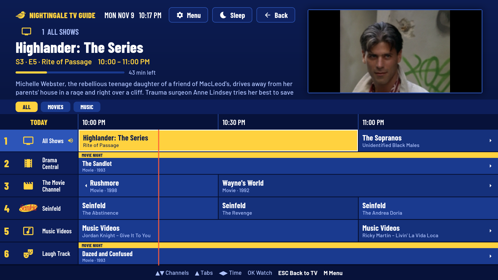
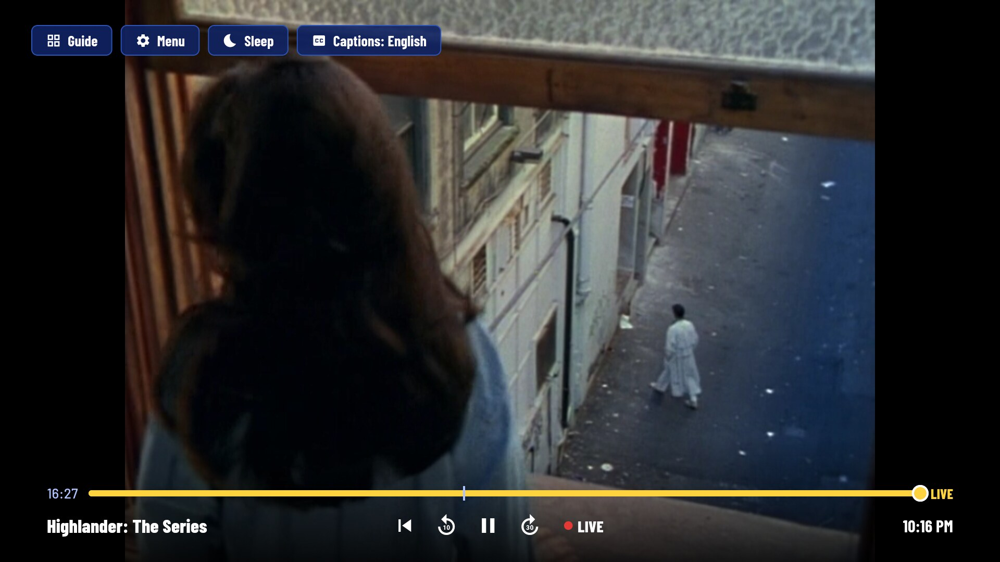
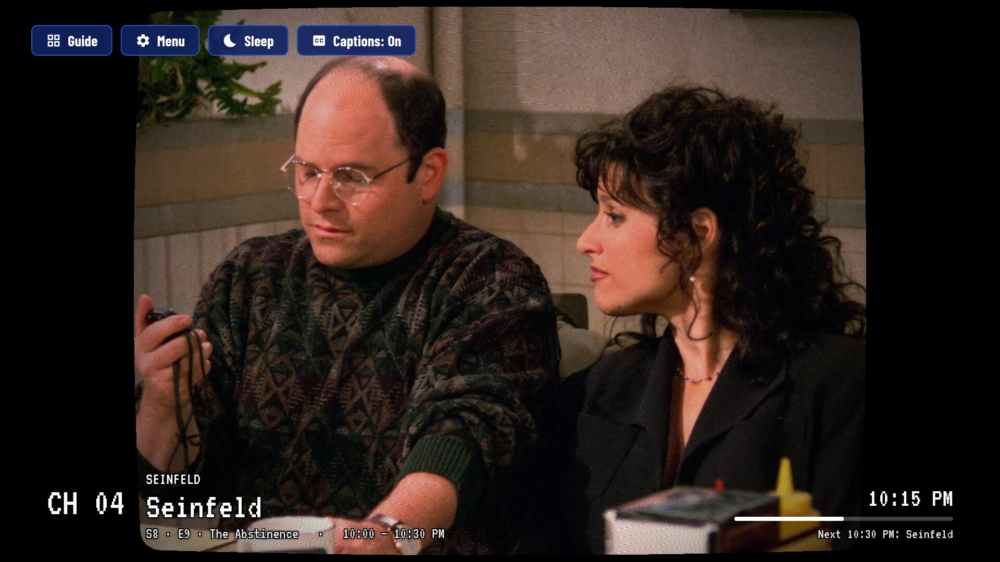
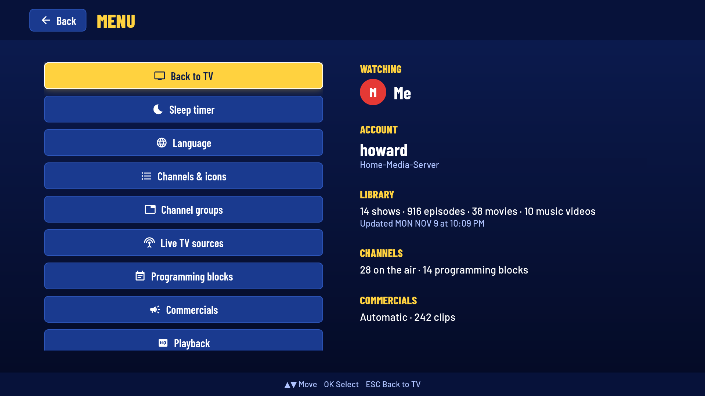
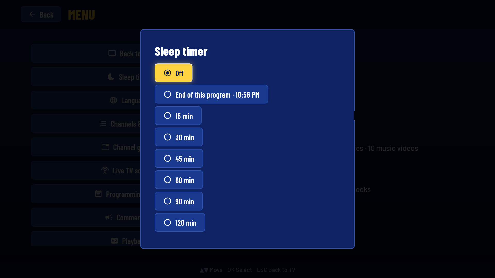
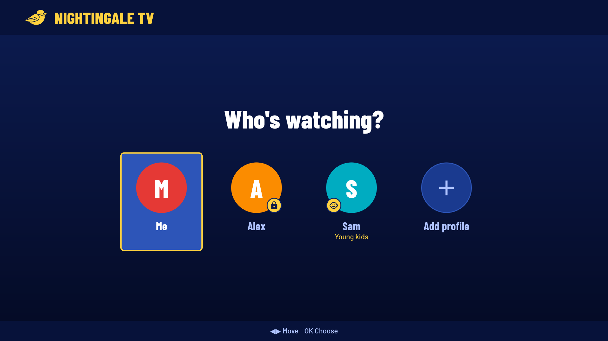
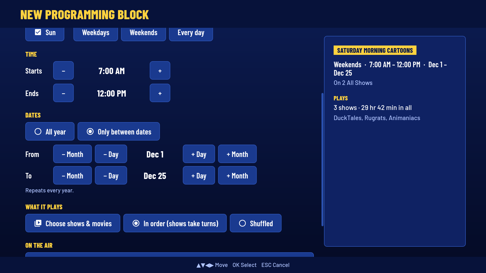
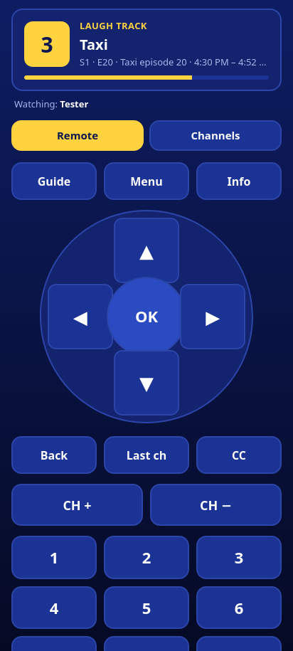

# Nightingale TV

Nightingale TV turns your Jellyfin, Emby or Plex library, or the video folders on a NAS or shared drive, into always-on cable TV channels, plus music video and radio channels and channels from your YouTube subscriptions, with a program guide. It's an Android app first, made for Android TV (Google TV and other Android TV boxes) and also at home on Android phones and tablets. There's a desktop version for Linux too, and a macOS version is planned. Like real TV, every channel is always mid-broadcast. You tune in to whatever is on, flip channels, and check the guide to see what's coming up.

It's built for the couch, so everything works with a TV remote, an air mouse, a touchscreen, your phone, or a keyboard and mouse.



## Contents

- [Features](#features)
  - [Channels](#channels)
  - [The guide](#the-guide)
  - [Watching](#watching)
  - [Commercial breaks (experimental, off by default)](#commercial-breaks-experimental-off-by-default)
  - [Your household](#your-household)
  - [Watch on your other screens](#watch-on-your-other-screens)
- [Install](#install)
  - [On Android](#on-android)
  - [On a computer](#on-a-computer)
  - [What you need](#what-you-need)
- [First start](#first-start)
- [SMB shares](#smb-shares)
- [YouTube channels](#youtube-channels)
  - [Your own Google client](#your-own-google-client)
  - [Building it yourself](#building-it-yourself)
- [Controls](#controls)
  - [Captions](#captions)
- [Phone remote](#phone-remote)
- [Backup and restore](#backup-and-restore)
  - [Moving to a new device](#moving-to-a-new-device)
- [Sharing](#sharing)
  - [Sharing channels](#sharing-channels)
  - [Friends watching](#friends-watching)
  - [Watching together](#watching-together)
  - [Running your own sharing backend](#running-your-own-sharing-backend)
- [Live TV export](#live-tv-export)
- [Running it as a server](#running-it-as-a-server)
- [Building from source](#building-from-source)
  - [Building for Android](#building-for-android)
  - [Building for Linux](#building-for-linux)
- [Privacy](#privacy)
  - [YouTube](#youtube)
  - [Sharing accounts](#sharing-accounts)
  - [What friends can see](#what-friends-can-see)
  - [Error reports](#error-reports)
- [Reporting a problem](#reporting-a-problem)
- [License](#license)
  - [Third-party software](#third-party-software)

## Features

### Channels

- **Channels made for you.** The app builds a lineup from your library: an all-shows channel, genre channels for shows and movies (comedy, kids, sci-fi…), decade channels ("90s TV", "80s Movies") and pairs of the two ("80s Action Movies"), marathon channels for your biggest shows, and movie channels. Show genre channels run like cable: a **Daytime** stack of shows at the same times every day from 6 AM to 6 PM, and an **Evening** block of the genre's movies until midnight when there are enough of them. Rename, renumber, hide or favorite any channel, and give it a built-in icon, a station badge, a show logo or your own image.
- **Build your own channels.** In Channels & icons → **New channel**, mix collections, folders, shows, seasons, genres and movies into a channel of your own, such as "80s Sitcoms" or "Saturday Night Movies". Play them **In order**, **Shuffled** or **Least watched first**. Channels you build are kept when you reset the lineup.
- **Programs that start on the clock.** Give any channel a **slot length** (15 minutes to 2 hours) so every program starts on time. Fill the rest of each slot with clips from a commercial pool or an offline image of your own, or choose **Truncate** to end programs that run long.
- **Always on the air.** Channels run on the clock, so you join a show mid-episode, just like flipping to it on cable.
- **Programming blocks.** Set up lineups such as "Saturday Morning Cartoons" on chosen days and times, or only during a date range each year ("Christmas Specials, Dec 1–25"). A block plays a mix of shows, movies, collections and folders, or a lineup you program slot by slot (DuckTales, then two Animaniacs, then Rugrats). Each airing picks up where the last one left off.
- **Late-night blocks.** A block can play only what's rated at or above a minimum rating, so a channel can drift into mature programming late at night. **New late-night block** sets one up in a step: "Late Night", every day from 11 PM to 4 AM, TV-MA and up. Blocks can follow one another (TV-14 and up at 9, TV-MA and up at 11). Kid profiles never get them.
- **New episode premieres.** Episodes newly added to your server premiere in prime time (8:00 PM by default) on a channel that plays the show, one new episode per show each night, marked **NEW** in the guide, the banner and the Up next card. Change the time and days or turn it off in Programming blocks → **New episode premieres**.
- **Music channels.** Music libraries and music videos get their own channels: **Music Videos** and **Music Radio**, plus genre and decade channels when your library is big enough ("80s Radio", "Rock Music Videos"). Songs play over a full-screen **Now Playing** card with the album art, song, artist and album. The same artist never plays twice in a row, music channels have no commercial breaks unless you turn them on, and music never shows up in your server's play history.
- **Live TV channels.** Add real broadcasts and IPTV to the lineup in Menu → **Live TV sources**: your Jellyfin, Emby or Plex server's Live TV (an HDHomeRun or other tuner on the server), or any **M3U playlist** with an **XMLTV guide**, from a web address or a file. Pick the channels you want, and they join the guide with their own logos and listings, numbered from the next hundred (100, 101…). Live channels play from the live point, reconnect after a drop, and have no commercial breaks. Kid profiles don't get them.
- **YouTube channels.** Sign in with your Google account (Add a server → **YouTube**) and pick up to 5 of your subscriptions, or as many as you like with your own Google client. Each becomes a channel in the guide that plays its uploads back to back, newest first, in YouTube's own player. See [YouTube channels](#youtube-channels).

### The guide

- **Program guide.** A scrolling cable-style grid with a live preview window, programming blocks labeled across their time slots, and an "Up next" card near the end of each show. It reaches 8 hours ahead, or 3 or 5 (**Guide range** in Channels & icons).
- **Guide tabs and channel groups.** Tabs at the top of the guide show **All**, **Favorites**, **Movies**, **Music** and **Kids** channels, plus groups you make yourself in Menu → **Channel groups**. Channel up and down still go through every channel, and exported M3U playlists use your groups as categories.
- **A phone layout.** Held upright, a phone shows the picture on top, what's on now and next below it, and a scrolling channel list under the tabs. **Full screen** turns it sideways into the TV layout.

### Watching

- **Pause and rewind.** Pause what's on, skip back 10 seconds or forward 30, **Restart** the program, or go back to **Live**, from the transport bar (◀ or ▶ while watching) or the remote's Play/Pause, Rewind and Fast-forward buttons. You can go back to the start of the program on now, or 30 minutes, whichever is earlier. Nothing is recorded: the channel's schedule is simply played a little later for you. Turn it off in Menu → **Playback** to keep every channel on the clock. Live channels can't be paused.
- **Sleep timer.** Stop playback after 15 minutes to 2 hours, or at the end of the program on now, and let the TV sleep. Press S, or choose **Sleep timer** in the menu.
- **Are you still watching?** After 4 hours with no button pressed, the app asks, and stops playback if nobody answers within a minute, so your server stops streaming. Change it to 2 or 8 hours, or turn it off, in Menu → **Playback**.
- **Captions.** Pick a subtitle track with the **Captions** button or the remote's Captions key, in four sizes (Small to Extra large, in the Captions list or Menu → **Playback**). See [Captions](#captions).
- **On-screen clock.** Shows the time in the corner of the picture (off by default, in Menu → **Playback**).
- **Volume leveling.** Evens out the volume as you watch, so loud commercials and quiet shows come out about the same (off by default, in Menu → **Playback**). On Android, surround audio is decoded on the device while it's on, instead of passed through to a receiver.
- **Channel logo in the corner.** A translucent station logo sits in the bottom-right corner of the picture, like a network's. Show it **Always**, **Now and then** (for 20 seconds when a show starts or comes back from a break, and at each quarter hour) or **Off**, for every channel or for one.
- **Retro look.** Make a channel look like an old TV in Menu → **Retro look**: a **4:3 picture** (filled or fitted) with a black, charcoal, channel-colored or picture surround, a **CRT effect** (Soft tube, Living room, Arcade, Studio monitor, or your own mix of scanlines, glow, curvature and color), and an **overlay theme** for the banner and channel number (Standard, VCR, Cable box, Station ident). Set it for every channel and override it for any one. **Effects on this device** turns the CRT effects off on a slower TV without changing anything else. Exported streams are never changed.

  **On NVIDIA Shield, curvature and glow aren't available** (Retro look shows them as "Not available on this device"). On NVIDIA devices the app draws its interface with Flutter's older renderer (Skia), the one Shields have been running, rather than the newer one (Impeller). Curvature and glow over the picture are a GPU shader filter that only Impeller can run. The video itself is shown by Android, not by Flutter. Scanlines, mask, vignette and color all work on the Shield.
- **Quick channel changes.** The app keeps its connections to your server ready, remembers how each file plays, and loads the next part of a channel before it's due, so channels come up fast and breaks play in and out with no gap.
- **Always direct play.** Nightingale TV plays your original files and never asks your server to transcode, unless you turn on **Transcode only if needed**. Then pick a **maximum bitrate** (40 Mbps · 4K down to 4 Mbps · 720p) for Wi-Fi or a remote connection, and your server converts only what's above it. *Original*, the default, never converts because of bitrate. While watching, **Quality** in the player's controls changes it at once: the program plays on from the same point under the new limit, and picking a limit there turns **Transcode only if needed** on.

### Commercial breaks (experimental, off by default)

Make TV feel like TV again, with ads between and during shows. Being experimental, this may change between versions. The rest of the app works the same with breaks off.

- **Your own ads.** Pick the folders or collections on your server that hold your commercials. Their videos leave your regular channels and fill the breaks instead.
- **Bumpers around the ads.** Set a pool's type to **Bumpers** and its station idents open and close the breaks. A Custom plan can pick its own bumper pool or turn them off, so a channel can have its own idents.
- **Ad compilations split automatically.** Long compilations (an hour of '80s ads in one file, say) are cut into individual ads at their chapters, or, on a computer, where the picture goes black and silent.
- **Breaks where they belong.** Ads play before, during and after shows and movies. Mid-show breaks go at act breaks when the show's chapters mark them, and otherwise at a scene change near evenly spaced points.
- **Automatic or Custom.** **Automatic** lays breaks out broadcast-style, fitting the ads so shows start on the hour and half hour, with no break longer than 5 minutes. **Custom** sets how long each break is, how often shows break and which ads each break uses, for every channel or for one.
- **Break notices.** A small countdown says when a break is about to start and when the program is coming back (on by default, in Menu → **Playback**).
- **Same ads for everyone.** Like real TV, tuning away and back shows the same ads at the same spot. Ads never show up in your server's watch history.

### Your household

- **Ten languages.** English, Deutsch, Français, Español, Português (Brasil), Italiano, 日本語, 简体中文, 繁體中文 (Taiwan) and 繁體中文（香港）, set per profile under Menu → Language. Automatic follows the device. The web admin follows the browser and has its own Language menu.
- **Jellyfin, Emby and Plex.** Sign in to any of them. Every feature works on all three. The one exception: a Plex server that doesn't list its artists' music videos gets no music video channels.
- **SMB shares, no media server needed.** Add a NAS, a Windows shared folder or a Samba share as a server (Add a server → **SMB share**): pick it from the computers the app finds on the network, or type `smb://computer/share` or `\\computer\share`. Sign in with a user name and password, or as a guest, then say what each folder holds: TV shows, movies, music, music videos, home videos, commercials or bumpers. Titles, seasons and episodes come from the file and folder names (and `.nfo` files and artwork next to them, when there are any). SMB 2 and 3 are used, and old SMB1-only devices still work. See [SMB shares](#smb-shares).
- **Several servers in one lineup.** Add more servers to a profile in Menu → **Servers**, in any mix (Jellyfin at home and a friend's Plex, say). Their libraries become one, and something on two servers appears once and plays from the first in your **Play from** order that answers. Give a slow remote server its own **Quality limit**. If one server is down, the others keep playing. With **Server colours in the guide** on (Menu → Servers), every programme in the guide is tinted with the colour of the server it plays from, with a key under the guide; each server's **Guide colour** can be changed.
- **Profiles.** Everyone gets their own channels, blocks and settings. Kid profiles only see content rated for their age. Grown-up profiles and settings can be locked with a PIN.
- **Phone remote.** Turn it on in the menu, scan the QR code, and your phone's browser becomes the remote. There's nothing to install. See [Phone remote](#phone-remote).
- **Sharing with friends.** Add friends who also use Nightingale TV, with a 6-character code, a link or a QR code, and share channels you built: they arrive as a recipe your friend's app rebuilds from their own servers. In the official builds, or in your own builds with your own backend. See [Sharing](#sharing).
- **Backup and restore.** Your whole setup is backed up by itself whenever it changes, and the last big change (a restore, a lineup reset, a deleted profile) can be undone. Save a backup to a file, or move your setup to another device through your phone or computer. See [Backup and restore](#backup-and-restore).

### Watch on your other screens

- **Live TV export (desktop).** Your channels play in Jellyfin Live TV, Plex, Emby or any IPTV app on your home network, with the same schedule, breaks and ads as this TV. Each profile you export shows up as its own **HDHomeRun tuner**, with an **M3U playlist** and a three-day **XMLTV guide**. See [Live TV export](#live-tv-export).
- **Nightingale TV server (Docker).** Run your channels on an always-on machine such as a NAS instead of a desktop that has to stay open, and set everything up from a browser in its **web admin**: profiles, channels, blocks, commercials, Live TV sources, export, backups and user accounts. See [Running it as a server](#running-it-as-a-server).

| Watching, with captions and pause and rewind | Retro look: Living room CRT and VCR overlay | Menu |
| --- | --- | --- |
|  |  |  |

| Sleep timer | Who's watching? | Programming block editor | Phone remote |
| --- | --- | --- | --- |
|  |  |  |  |

## Install

Nightingale TV is free and open source. On Android there are three ways to get it, all built from this source code (the Google Play version also has a purchase module that isn't published here):

- **Buy it on Google Play** (coming soon), for Android TV, Google TV, phones and tablets: free for 14 days, then a one-time $4.99 (USD; Play shows your local price) unlocks it for good, and it updates by itself. Buying it supports the project.
- **Download it for free** from [Releases](https://github.com/tcaplette/Nightingale-TV/releases): the same Nightingale TV with nothing locked, signed with the same key, so the two install over each other and keep your setup. The APKs don't update by themselves. See [On Android](#on-android).
- **Build it yourself, for free.** See [Building from source](#building-from-source).

The desktop version (Linux) is free on [Releases](https://github.com/tcaplette/Nightingale-TV/releases), or you can build it yourself. See [On a computer](#on-a-computer).

### On Android

One app covers Android TVs, phones and tablets (Android 7.0 or newer). Each release has four APKs. Install the one for your device:

| APK | For |
| --- | --- |
| `nightingale-tv_<version>_arm64-v8a.apk` | Most TVs, TV boxes and phones from the last several years (Google TV, NVIDIA Shield, Pixel, Galaxy…) |
| `nightingale-tv_<version>_armeabi-v7a.apk` | Older or cheaper TV sticks and boxes (many no-name boxes) |
| `nightingale-tv_<version>_universal.apk` | Any of them, if you're not sure. It's several times larger. |
| `nightingale-tv_<version>_x86_64.apk` | Android Studio emulators on a PC |

`<version>` is the release's version and build number, such as `1.2.7+5009`.

On a phone or tablet, open the APK on the device and allow *Install unknown apps* when asked. On a TV, turn on *Developer options* and *USB debugging* (or *Network debugging*), then run `adb install nightingale-tv_<version>_arm64-v8a.apk` from your computer, or copy the APK over with a file manager app and open it there. To update, install the next release's APK over the old one; your profiles stay.

On Android the app fills the screen and keeps it on while it's in front. On a phone held upright it uses the [phone layout](#the-guide). Going to the home screen stops playback, and coming back tunes in to the same channel live.

#### Store version, official APKs and your own build

- **The Google Play version and the official APKs have the same app id and setup**, **Nightingale TV**. Each installs over the other and keeps every profile, channel and setting. The Google Play version has the 14-day free trial and the one-time purchase; the official APKs are free with nothing locked, and don't update by themselves.
- **Your own build is a separate app**, **Nightingale TV (own build)**. It installs beside the Google Play version with its own profiles, channels and settings, and nothing in it is locked. The **About this install** section of **Backup & restore** says which one you're in.
- **Moving your setup across:** in **Backup & restore**, pick **Move my setup to …** (or **Bring my setup here from …**). The other app opens and asks before restoring. It works with just a remote. A backup file works too (see [Moving to a new device](#moving-to-a-new-device)).
- **Don't uninstall first.** Uninstalling either app deletes its setup unless you've moved it or saved a backup file.

### On a computer

The desktop version runs on 64-bit (x86-64) Linux. Each release has two downloads:

| Download | For |
| --- | --- |
| `nightingale-tv_<version>.<build time>_amd64.deb` | Ubuntu 24.04 or newer, Debian 13 or newer, and distributions based on them (Linux Mint 22, Pop!_OS 24.04…) |
| `nightingale-tv-linux-x64-<x.y.z>.tar.gz` | Other distributions (Arch, Fedora, openSUSE…) from 2024 or newer |

For 1.2.7 these are `nightingale-tv_1.2.7+5009.20261125021121_amd64.deb` and `nightingale-tv-linux-x64-1.2.7.tar.gz`.

**The .deb:** in the folder it's in, run `sudo apt install ./nightingale-tv_*_amd64.deb` (the `./` matters: without it apt looks online). apt also installs the libraries Nightingale TV needs, ffmpeg included. Then open **Nightingale TV** from your app menu, or run `nightingale-tv`. To update, install the next release's `.deb` the same way; your profiles and settings stay. It needs Ubuntu 24.04 or newer because it uses libmpv version 2, and Ubuntu 22.04 only has version 1. On 22.04, build it yourself.

**The .tar.gz:** first install GTK 3, libmpv 2 (`libmpv.so.2`), OpenGL ES (Mesa) and ffmpeg from your distribution (on Arch: `sudo pacman -S gtk3 mpv mesa ffmpeg`). Unpack it anywhere and run `./nightingale_tv` in that folder. To update, unpack the next release over it.

**Building it yourself** on Ubuntu or another Debian-based Linux: set up the tools in [Building for Linux](#building-for-linux), then run `tool/install.sh` in the project folder. It builds a package and installs it with `apt`, like the release `.deb`. To update, pull the latest code and run it again. `tool/build_deb.sh` only makes the package (`dist/nightingale-tv_*_amd64.deb`), to copy to a computer on the same or a newer release. To uninstall: `tool/install.sh --uninstall` or `sudo apt remove nightingale-tv`. Your settings in `~/.local/share/com.coffeehauslabs.nightingale_tv` are kept.

**Only in the desktop version:** **Live TV export**, which needs ffmpeg and a computer that stays on, and splitting ad compilations by picture and sound. On Android, compilations are split only at their chapters (or Jellyfin's media segments).

### What you need

- An Android TV or Google TV device, or an Android phone or tablet, running Android 7.0 or newer. Or, for the desktop version, a 64-bit Linux PC: Ubuntu 24.04 or newer for the release `.deb` (Ubuntu 22.04 if you build it yourself), or another distribution from 2024 or newer for the `.tar.gz`.
- A [Jellyfin](https://jellyfin.org) server (10.11 or newer), an [Emby](https://emby.media) server (4.8 or newer), a [Plex Media Server](https://www.plex.tv) or an SMB share (a NAS, or a shared folder on a Windows, Mac or Linux computer) with your shows and movies, and music or music videos if you want music channels. You can add more than one.
- For YouTube channels on Linux: WebKitGTK and GStreamer's video plugins (the `.deb` installs them; with the `.tar.gz`, install `libwebkit2gtk-4.1-0`, `gstreamer1.0-plugins-good` and `gstreamer1.0-libav`). Android uses its System WebView.
- For the phone remote, a phone on the same Wi-Fi as the TV. See [Phone remote](#phone-remote) if the computer's firewall is on.
- On Linux, ffmpeg (the `.deb` installs it; with the `.tar.gz`, install it yourself). It splits long commercial compilations into individual ads, converts Live TV export's streams, and reads the files on SMB shares for their lengths. The Android app brings its own.

## First start

1. Enter your server's address. The app works out whether it's Jellyfin, Emby or Plex. For Plex you can also choose **Sign in with Plex** instead. For a NAS or shared folder, choose **SMB share** (see [SMB shares](#smb-shares)).
2. Sign in:
   - **Jellyfin or Emby:** with your username and password, or with **Quick Connect** when the server has it on, approving the TV from your phone.
   - **Plex:** go to plex.tv/link on your phone or computer and enter the code the TV shows. If the account can use more than one server, pick one, and in a Plex Home pick who's watching.
3. The app scans your library and builds your channels. That's it. It starts on channel 1.

To add another server to the same lineup later, use Menu → **Servers** → **Add a server**. It signs in the same way.

Moving from another device? Choose **Restore from a backup** on the sign-in screen. If the app finds a backup of its own when it starts with no profiles (after a reinstall, or from Android's backup), it shows **Welcome back** and offers to **Restore it**. See [Moving to a new device](#moving-to-a-new-device).

## SMB shares

An SMB share works like a media server in every part of the app: channels, blocks, breaks, captions, music, pause and rewind, Live TV export, sharing and backups.

- **Adding one.** Add a server → **SMB share**. The app lists the computers and NAS boxes it finds (over Bonjour, Windows network discovery and NetBIOS), then the shares on the one you pick; or type the address. A port can go in the address (`smb://nas:1445/media`). Sign in with a user name, password and, if the network uses one, a domain, or **Connect as guest**. A device that only speaks SMB1 is marked "SMB1: old and unencrypted".
- **Folders.** Choose what each folder holds, or **Nothing** to leave it out; a folder inside a chosen one can have its own choice. The app suggests a choice from folder names. Folders chosen as Commercials or Bumpers become commercial and bumper pools. **Folders** on the share's row in Menu → Servers changes them later, and **Rename** gives the share its own name.
- **Reading the files.** The first files are ready in seconds; the rest are read in the background (the row shows how many are left), and channels fill in as they're read. What's already on air never changes.
- **Files the device can't play.** Nightingale TV checks every file against what the device can play. On a computer, or the server, it converts what's needed with FFmpeg. On Android it plays what the device can, converts the rest with the FFmpeg it brings, and uses another Nightingale TV when that's faster (below). Files nothing can play (damaged, sound only, or too much for this device with no other Nightingale TV to convert) are listed under **Can't play** on the share's row, with the reason, and never scheduled; **Check again** after fixing one.
- **Converting on another Nightingale TV.** A Nightingale TV on a computer, or the [server](#running-it-as-a-server), can convert for TVs that can't play a file, or can't convert it fast enough themselves. Turn on Menu → **Convert for other TVs** there, then on the TV choose Menu → Servers → **Convert on other Nightingale TVs** and enter the 6-digit code it shows. It needs the same share in one of its profiles and only converts files in that share's mapped folders. It listens on port 8487.
- **Watch history.** Play counts and resume points are kept in a hidden `.nightingale` folder on the share, under a **History name**, so TVs that use the same name share them; nothing else on the share is changed. On a read-only share, or with **Keep history on this device**, history stays on the device.
- **Home videos** are never shared with friends: a shared channel leaves them out, and friends see "Home video" instead of a title.
- **Passwords** are kept encrypted on the device (with the Android Keystore on Android), and never in backups, logs, error reports or the web admin. A backup restored on another device asks for the share's password again.

## YouTube channels

Your own YouTube subscriptions can be channels in the guide, beside your library's. Each picked YouTube channel plays its videos back to back, newest first, in YouTube's own player, on Android (TV, phones and tablets) and Linux.

- **Adding it.** Add a server → **YouTube** (or **YouTube** on the first sign-in). The app shows a code: on your phone or computer, go to **google.com/device**, sign in with your own Google account and enter it. Signing in means agreeing to [YouTube's Terms of Service](https://www.youtube.com/t/terms) and the [Nightingale TV privacy policy](https://coffeehauslabs.com/ntv/privacy). The app asks only to see your YouTube account, read-only.
- **"Google hasn't verified this app".** Google may show this warning on its page: *"You've been given access to an app that's currently being tested. You should only continue if you know the developer that invited you."* It appears because Nightingale TV's Google project is still in Google's Testing stage and hasn't been through Google's verification. Choose **Continue**, then tick the box that lets Nightingale TV see your YouTube account, and choose **Continue** again. If that box is left unticked, the app can't read your subscriptions: it says so and shows a new code. While the project is in Testing, only Google accounts added as testers can sign in with it, and Google ends each sign-in after 7 days: sign in again when the app asks (or with **Sign in again** on YouTube's row in Menu → Servers). [Your own Google client](#your-own-google-client), set to In production, works for any Google account you sign in with and doesn't end after 7 days; its own unverified-app warning shows once.
- **Picking channels.** Next comes a list of your subscriptions, with a search field. Check the ones you want and choose **Done**. On Nightingale TV's Google client, a profile can have up to **5 YouTube channels**, across all of its YouTube accounts that use it. With [your own Google client](#your-own-google-client) there's no limit. At 5, the other subscriptions are greyed and say where to set up your own client. Change them later with **Channels** on YouTube's row in Menu → Servers. Then choose the YouTube server's guide colour (it starts as wine).
- **What plays.** Each channel's long uploads, newest first; Shorts, live and upcoming streams, private and age-restricted videos, and videos that can't be played outside YouTube are left out. New uploads come in at most every 6 hours and play right after what's on the air. YouTube's ads, captions and logo are its own, and an air mouse or a finger can use YouTube's Skip ad.
- **Nothing over the picture.** YouTube's rules don't allow anything drawn over its player, so when the channel banner, the channel number or another message shows, the picture moves out of its way. The player stops whenever it isn't on screen (Menu, another screen, the app in the background) and starts again at the scheduled point.
- **Not on YouTube channels:** commercial breaks, bumpers, premieres, programming blocks, the retro look, volume levelling, rewind, the on-screen clock, picking a quality (YouTube chooses it, so **Quality** shows *Auto*), sharing and watching together. YouTube's terms allow its videos only in YouTube's own player, so YouTube channels are also left out of the [Live TV export](#live-tv-export): Plex, Jellyfin, Emby and IPTV players never get them.
- **On the server.** The [server](#running-it-as-a-server) has YouTube too, with your own Google client only: set it up in the web admin and watch the channels on its **Watch** page.
- **YouTube's daily limit.** Everyone using Nightingale TV's Google client shares one daily allowance of YouTube requests. If it runs out, channels keep playing the videos they have, and Menu → Servers says when new videos come (midnight Pacific time).

### Your own Google client

With a Google client of your own, the daily limit is yours alone, sign-ins don't end after 7 days, and you can pick as many YouTube channels as you like (Nightingale TV's client allows 5). In Menu → Servers → YouTube → **Google client**, enter its Client ID and Client secret (the phone remote can type them), or on a phone or computer open the file Google downloads. The steps are on that screen, and in full at [coffeehauslabs.com/ntv/youtube-client](https://coffeehauslabs.com/ntv/youtube-client). The client must be of the type **TVs and Limited Input devices**. Your channels, their numbers and colour stay as they are. **Use Nightingale TV's client** on the same screen goes back to the app's client; with more than 5 YouTube channels, remove some in **Channels** first.

### Building it yourself

Release builds include Nightingale TV's Google client. Its file is never in the source, so if you fork or clone the project, create your own: in a Google Cloud project with the **YouTube Data API v3** turned on, make an OAuth client of the type **TVs and Limited Input devices**, download its JSON file and save it as `assets/youtube/client/nightingale-tv-youtube.json` (git-ignored; the folder's README says the same). Every build then signs in through Google with it: `flutter run`, VS Code or the `tool/` scripts. Without the file, the app still builds, and choosing **YouTube** says the build has no YouTube client.

## Controls

| Remote button (keyboard) | Watching TV | In the guide |
| --- | --- | --- |
| ▲ ▼, Channel Up/Down (Page Up/Down) | Change channel | Move between channels (▲ from the top row reaches the guide tabs, then **Menu**) |
| ◀ ▶ | Open the pause and rewind controls (the banner on a live channel, or with Pause and rewind off) | Move through time (on the tab row, pick a tab) |
| Play/Pause (P), Play, Pause | Pause or resume | |
| Rewind, Fast-forward | Back 10 seconds, forward 30 (hold to go faster) | |
| Info (I) | Show the banner | |
| OK (Enter) | Open the guide (resume, while paused) | Watch that channel |
| Guide (G) | Open the guide | Back to TV |
| Back (Esc) | See below | Back to TV |
| 0–9 | Go to a channel number | |
| Last or Recall (Backspace, L) | Last channel | |
| Captions (C) | Captions on/off, in the language picked last | |
| (S) | Sleep timer | |
| Menu (M, right-click) | Menu | Menu |
| (F11) | Full screen on/off, on a computer | |

**Back** works as Esc does on every screen, except on the TV picture itself on Android: there it shows "Press Back again to exit", and a second Back within 3 seconds closes the app. On a computer, Esc on the TV picture opens the guide.

**With an air mouse:** move the pointer while watching, and **Guide** and **Menu** buttons appear in the top-left corner, with **Captions** and **Quality** at the bottom right. In the guide, click a channel to watch it, click a tab to filter the channels, or click **Menu** at the top.

**On a phone or tablet:** tap where you'd click and long-press where you'd right-click (the TV picture or the guide opens the menu). Tapping the picture shows the pause and rewind controls, with the guide among them. Drag to scroll the guide and lists. The back gesture works as the Back button does.

### Captions

**Captions** and **Quality** sit at the bottom right of the picture while the controls are up. With the transport bar, press ◀, then ▼, then ▶ twice to reach **Captions**. Without it (live channels, YouTube channels, or with Pause and rewind off), press ▶ and then ▼. On a phone the **Captions** button sits beside **Menu** over the player, followed by **Quality**. The list shows **Off** and every subtitle track of the program, in the file or beside it (`Movie.en.srt`), plus the caption size. Your pick is saved for the profile, so later programs on any channel show a track in the same language. On a live TV channel the choice is just **Off** or **On**.

## Phone remote

Menu → **Phone remote** turns it on, on Android TV and the desktop version. Scan the QR code with your phone's camera, or open the address shown and type the 6-digit code. The phone has to be on the same Wi-Fi as the TV, and the remote answers while Nightingale TV is open.

- **Pairing** works only while the Phone remote screen is open, and a paired phone works with that TV only. Up to 20 phones stay paired; the screen lists them, with **Remove** and **Remove all**.
- **Is it working?** The screen says **Working**, **Not confirmed yet**, or **Blocked** when a firewalld firewall stops phones, with the command to fix it.
- **If the phone can't connect,** check it isn't on a guest network or mobile data, and that the Wi-Fi doesn't keep devices apart ("AP isolation" or "client isolation").
- **Firewall on Linux** (only if ufw or firewalld is on). Android TV needs nothing. The `.deb` installs firewall profiles for the remote's ports (8642 to 8651) but never opens them. Allow them once:
  - ufw: `sudo ufw allow "Nightingale TV Remote"`
  - firewalld: `sudo firewall-cmd --permanent --add-service=nightingale-tv-remote && sudo firewall-cmd --reload`

  With the `.tar.gz`, allow the port the screen shows instead, usually `sudo ufw allow 8642/tcp`.
- The remote only works on your home network. Don't open a port for it on your router.
- **In a watch party** the phone also shows a reaction pad, which sends reactions as the TV's profile and goes away when the TV leaves the party.

## Backup and restore

Menu → **Backup & restore** (grown-ups only, when there are kid profiles) shows when your setup was last backed up, with **Save to a file**, **Open a backup file**, **Use your phone or computer** and, after a big change, **Undo**.

- **The automatic backup.** The app keeps one backup of your setup on the device and rewrites it when something changes. It checks after start-up, every 6 hours, and when the app goes to the background. Changing channel doesn't count as a change.
- **Undo.** Right before a restore, a lineup reset, a profile delete or a settings update, the app saves an undo point, and Backup & restore offers **Undo restore**, **Undo lineup reset**, **Undo deleting Kids** and so on. Only the most recent change can be undone, and an undo can itself be undone.
- **A copy you keep.** The app doesn't keep a list of backups. For a copy that stays as it is, use **Save to a file**.
- **Picked Live TV files.** The automatic backup leaves out guide files you picked from the device, and very large picked playlists, so it stays small. After restoring it, the source's channels keep their numbers, and its card says **Pick the guide file again** (or the playlist). Pick the file through **Edit**. **Save to a file**, the phone or computer **Download backup** and **Move my setup** carry every picked file.

**A backup holds** every profile with its PIN and all its channels, groups, blocks, commercial settings and custom images, plus the Live TV export and phone remote settings.

**It never holds** server sign-ins, sharing sign-ins or paired phones, so a backup file can't get anyone into your server or your sharing account. A restored profile asks you to sign in once unless it's still signed in on this TV. The library index and media analysis are rebuilt by themselves.

**Restoring** replaces everything on this device, after saving the current setup as the undo point (**Undo restore**). Opened and uploaded backups go straight to the restore confirmation and aren't kept. Channels come back on the same schedule, so the same show is on the air as on the old device.

### Moving to a new device

- **A computer:** on the old one, **Save to a file**. On the new one, choose **Restore from a backup** → **Open a backup file** on the first sign-in screen (later, Menu → Backup & restore → **Open a backup file**). Android phones and tablets can do the same with the system's file picker.
- **Any device, Android TVs included:** on the old device, Backup & restore → **Use your phone or computer**, scan the code and tap **Download backup**. On the new one, choose **Restore from a backup** → **Use your phone or computer**, scan its code and tap **Restore from a file**. The phone and both devices need to be on the same Wi-Fi.
- **Android's own backup:** with Google backup on, Android keeps the automatic backup in your Google account (never the undo point), and a reinstall offers to **Restore it**. Picked guide files aren't in it.
- **Live TV export moves with the backup.** The restored computer answers as the same tuners, so Plex and Jellyfin keep their setup. Turn export off on the old one.

## Sharing

Menu → **Sharing** lets you add friends who also use Nightingale TV. It's on grown-up profiles only; kid profiles never have it. The official builds (Google Play, and the APKs and `.deb` on Releases) share on the official network. Builds from source can run their own sharing backend: see [Running your own sharing backend](#running-your-own-sharing-backend). Each build only reaches friends on its own network.

- **Setting up.** Choose **Set up**, enter your email, and type the 6-digit code that arrives by email. There's no password. Then pick a display name, a handle such as `@tyler`, an avatar from the built-in set, and, if you like, a station name. Each Nightingale profile has its own sharing account, so the same email on another TV signs in to the same account and friends.
- **Adding friends.** **Add friend** shows your code (such as `AB3K·9Q`), its link and a QR code. A friend types the code in their Nightingale TV under Sharing → **Add friend** → **Enter a code**, or opens the link, and you're friends on both sides. On a phone or tablet, **Send invite** shares the link through any app. A code works once and expires after 7 days; **New code** replaces it at once. On Android, opening an invite link goes straight to Nightingale TV.
- **Friends** can be removed, or blocked: a blocked account stops being your friend and can't use your codes. The **Blocked** list unblocks them.
- **No video is ever sent between users.** Each person plays from their own media server.

### Sharing channels

**Share channels** sends friends channels you've built, such as "90s Sitcoms" or a Saturday-morning block. Check one or more channels, then pick friends, or choose **Get a link**. A link gives a code, link and QR code (and **Send invite** on phones and tablets). Whoever uses it within 7 days becomes your friend and gets the channels; it works once. A channel's details also have **Share…**. Live channels (they play from your own tuner) and music channels can't be shared, and the list says why. Neither can a channel with more than 20,000 programs.

**What's sent is a recipe, not video.** A shared channel is a description of what it plays, which your friend's app rebuilds from their own servers:

- **It holds** the channel's name, its icon when it's a built-in one, your station name, the play order and start time, the break plan's lengths, the slot length, the retro look and logo setting, the programming blocks (name, days, times, order and programs), and every program in play order: an episode as its show's TVDB/TMDB/IMDb ids, name and year plus season, episode number, title and runtime; a movie as its ids, title, year and runtime.
- **It never holds** server addresses or names, item ids, file or stream paths, tokens, images, commercial, bumper or slot pools, or play counts. A channel with a server image as its icon arrives with a number badge instead.

To fill in provider ids, a profile that's set up for sharing asks all its servers for them during library scans, as a profile with several servers does.

**Shared with you.** New shares wait under Sharing → **Shared with you**, with who sent them and how much of each channel your servers have ("Matched 38 of 42 programs"). **Add** puts the channel on your lineup with the next free number, on the air at once, and under the guide's **Shared** tab. **Decline** removes it from the list. If none of its programs are on your servers, only Decline is offered. The menu's Sharing entry shows how many shares are waiting, and the TV shows a short notice when new ones arrive. The notice never takes focus from what you're watching.

**Matching.** Shows match by a shared provider id, otherwise by name and year. Episodes match by season and episode number (by title when they have no numbers). Movies match by provider id, otherwise by title and the same year; a movie with no year never matches by title alone. Programs you don't have are left out, and the rest keep the sender's order and play with your runtimes. With the same library, your guide for the channel matches the sender's. After every library scan the copy is matched again, so episodes you add later join it in their places.

**Keep updated** (in the copy's details, on by default). When the sender changes a shared channel, your copy picks the change up the next time your app connects, without moving what's on the air. Your own name, number and icon stay. Renaming, renumbering, changing the icon, retro look, logo or break plan keeps it on. Changing the copy's programs or blocks turns it off and says so; turning it back on rebuilds the copy from the sender's channel. If the sender stops sharing, removes the channel or stops being your friend, or either account is deleted, the copy stays on your lineup, marked "No longer updated".

**Channels you share** lists each shared channel with the friends who have it. **Stop sharing** ends it for everyone; their copies stay, without your later changes.

### Friends watching

With **Show what I'm watching** on Friends, your friends see what you're watching, and you see what they're watching:

- **Sharing → Friends:** each friend's line says "Watching *The Office* on 90s Sitcoms" while they watch.
- **Guide:** on a channel you share or added from a share, the friends on that same channel show as avatars on its row, and "Tyler is watching" in the program on now.
- **Player:** tuning to a shared channel a friend is on shows "Tyler is watching too" in the corner for 5 seconds, and the banner shows their avatars. Opening the app shows "Tyler and Sam are watching now" once, when friends are on channels you have.

None of it takes focus from what you're watching. The question is asked once, as the last step of setting up sharing (or the first time Sharing opens after updating), and the setting is under Sharing at any time. **Watch privately**, in the player's buttons, hides what you watch until you turn it off or close the app. See [What friends can see](#what-friends-can-see).

**What's stored, and where.** The official builds' sharing uses a hosted backend run for this project ([Supabase](https://supabase.com)); a self-hosted build uses its owner's. It holds your email, your share profile (name, handle, avatar and station name), your friends and blocks, the invite codes you made, and the recipes of channels you share. A recipe can be read only by you and by friends whose share of it is active. Your email is never shown to anyone, friends included. The invite page (on coffeehauslabs.com for the official builds) shows a live code's name, handle and station, and nothing for a used or expired code. The sign-in itself stays on the device: it isn't in profiles or backups, and a restore keeps it. The app only contacts the backend while a signed-in profile is on screen, never in the background or while asleep, and not at all for profiles that aren't set up.

**Sign out** unlinks the profile on this device only; your account and friends stay. **Delete sharing account** deletes the account, its share profile, its friendships, invites and everything stored for it, and signs it out on every device.

If the backend can't be reached, Sharing says "Sharing is unavailable right now"; watching TV is never affected.

### Watching together

**Watch together**, in the player's buttons on a Nightingale channel (after Sleep), starts a watch party for what's on: pick up to 7 friends, or choose **Get a link** for a code, link and QR code (and **Send invite** on phones and tablets). A party holds up to 8 people. Live channels don't offer it, since they play from your own tuner, and kid profiles never have it.

- **How it stays in sync without video.** No picture or sound goes between members. The host's app sends only the timing: which program is on (described as a shared channel describes it, by show ids, season and episode, or a movie's ids, title and year), where it is, and whether it's paused. Each member's app plays its own copy from its own servers at that position, timed by the sharing backend's clock. A member more than 2 seconds off jumps to the right place; smaller drift is corrected by playing 5% faster or slower for a moment, which you won't hear. When the host's program ends, everyone moves to the host's next program. Joining late starts at the current position. Each member's app sends a few small messages a minute, well under 1 MB in 10 minutes.
- **A program you don't have.** If your servers have no copy of what's on, you see "Not on your servers: *The Office*. You'll rejoin at the next program." The party row and reactions keep working, and your picture comes back when a program you have starts.
- **Breaks.** When the host's channel goes to a commercial break, each member plays a break of the same length from their own commercials and bumpers, or the break card if they have none. The program resumes for everyone together.
- **Pause and skip for everyone.** Any member's Pause/Play, Back 10, Forward 30, Restart and Live act on the whole party within 2 seconds, and every screen says who did it ("Sam paused"). The host's rewind window is the party's.
- **Reactions.** While the controls are up, the party row shows everyone's avatars (the host's marked), whether you're "In sync", "Catching up" or "Not on your servers", **Invite** (for the host), six reactions (😂 😮 ❤️ 👏 😱 🍿) and **Leave**. A reaction floats up the side of everyone's picture with your avatar for 3 seconds; one per second each. The D-pad, an air mouse and touch all work, and a paired [phone remote](#phone-remote) shows a reaction pad while its TV is in a party. "Sam joined" and "Sam left" show for 3 seconds. Nothing in a party takes focus from what you're watching.
- **Invites.** A friend whose app is open sees "Tyler invited you to watch *The Office* together" at the top, with **Join** and **Not now**. The first Up (from the picture, or from the guide's top row) reaches it, a mouse or finger can tap it, and Back dismisses it; channel up and down still change channels. It goes after 30 seconds. Open invites stay in Sharing → **Watch parties** until the party ends. A watch link makes whoever opens it your friend and asks "Join Tyler's watch party?".
- **Leaving.** Back, changing the channel, picking another channel in the guide, or tapping a channel on the phone remote asks "Leave the watch party?" on the TV first (Stay is the button already selected). A member who leaves goes back to their own channels, on the channel they had before joining. When the host leaves, closes the app, or is gone for 60 seconds, the party ends for everyone: "Tyler ended the watch party". Sending the app to the background or to sleep leaves the party.

**What a party stores.** The backend keeps the party (its host, the channel's name and the latest timing), who's in it and who was invited. Only its members and invitees can read them, and only members receive its messages. A party is deleted with its host's sharing account, and a member's rows with theirs.

### Running your own sharing backend

If you cloned this repository, your builds have no Sharing until you give them a backend of your own. The official backend's keys aren't in the repository. You need three things: a database (a [Supabase](https://supabase.com) project, and the free plan is enough), an SMTP relay to email the sign-in codes, and a static website for invite links. Everything you need to deploy is in this repository: the database schema and data rules in `supabase/migrations/`, the Edge Functions in `supabase/functions/`, the deploy script `supabase/deploy.sh`, and the invite page in `invite_page/`.

**A self-hosted backend is its own network.** People on your builds can be friends with each other, but not with people on the official builds.

Every private value goes into a git-ignored file. Copy each committed `*.example` file and fill in the copy. You need `bash`, `curl`, `python3` and `psql` on the computer you deploy from. [SELF_HOSTING.md](SELF_HOSTING.md) explains each step in full. In short:

1. **The database.** Make a Supabase project and keep its database password. Then `cp supabase-credentials.example.txt supabase-credentials.txt` and fill in:
   - `SUPABASE_PROJECT_REF`, the id in the dashboard address;
   - `SUPABASE_ACCESS_TOKEN`, from **Account → Access Tokens**;
   - `SUPABASE_DB_PASSWORD`;
   - `SUPABASE_DB_HOST`, the session pooler's host, under **Connect → Session pooler**.
2. **The SMTP relay.** Supabase's built-in mailer is only for testing, so sign-in codes go through your own SMTP service. Run `cp supabase/auth-config.example.json supabase/auth-config.json` and fill it in:

   | Key | [Resend](https://resend.com) | Any other SMTP service |
   | --- | --- | --- |
   | `smtp_host` | `smtp.resend.com` | your provider's SMTP server |
   | `smtp_port` | `465` | `465` (TLS) or `587` (STARTTLS) |
   | `smtp_user` | `resend` | your SMTP user name |
   | `smtp_pass` | your Resend API key (`re_…`) | your SMTP password |
   | `smtp_admin_email` | the sender address, such as `noreply@example.org` | the same |
   | `smtp_sender_name` | the sender's name, such as `Nightingale TV` | the same |
   | `site_url` | your invite website, such as `https://invites.example.org` | the same |

   Verify the sender's domain with your email service first (with Resend, its SPF and DKIM records under **Domains**). Until you do, codes aren't delivered. The email's subject, text, code length, expiry and rate limits stay in the committed `supabase/auth-config.base.json`, so every build sends the same email.
3. **The function secrets.** `cp supabase/functions/.env.example supabase/functions/.env`, then set two values:
   - `PREVIEW_SALT`: a random string, such as the output of `openssl rand -hex 24`;
   - `INVITE_ORIGIN`: your invite website's origin, such as `https://invites.example.org`.
4. **Deploy:** `supabase/deploy.sh all`. It applies the migrations, sends the secrets, sets the email settings and deploys every function, in that order. Each step can also run on its own: `migrations`, `secrets`, `auth` or `functions`. It checks everything before sending any request and stops with the name of anything missing, such as `smtp_pass is not filled in`. Run it again after every update of your checkout. Migrations already applied are skipped.
5. **The invite page.** Copy `invite_page/` to a static host at the root of its own host name, such as a GitHub Pages user site or a custom domain. In the copy:
   - fill in `config.js`;
   - rename `.well-known/assetlinks.json.example` to `assetlinks.json` and put your signing key's SHA-256 fingerprint in it, so invite links open your app.
6. **Point your builds at it:** `cp sharing.env.example sharing.env`, then fill in:
   - `NTV_SHARE_URL`: `https://<project ref>.supabase.co`;
   - `NTV_SHARE_KEY`: the project's **publishable** key, never the secret key;
   - `NTV_SHARE_HOST`: your invite host, such as `invites.example.org`.
7. **Build a release** with `tool/build_apk.sh`, `tool/build_linux_release.sh` or `tool/build_deb.sh`. They read `sharing.env` on their own. For releases built by GitHub Actions, add the same three values as repository secrets. Only release builds have Sharing.
8. **Before publishing your fork**, run `tool/check_public_secrets.sh`. It fails if a value from any of the four private files appears in a file that would be published, and it never prints the value.

## Live TV export

Live TV export is part of the desktop version. It lets the Plex and Jellyfin apps on your other TVs, phones and computers play your channels, guide and all, without installing anything new on them. The schedule, programming blocks and commercial breaks are the same as on this TV, with the same ads at the same moments.

Nightingale TV has to stay open for the exported channels to play. Closing it takes them off the air.

**Turn it on:** Menu → **Live TV export**. Turn on **Live TV export**, then **export this lineup** for each profile you want to share. Each profile gets its own address, for example `http://192.168.1.20:5004`, and the screen shows its links and a QR code.

**Plex** (Live TV needs Plex Pass): Settings → **Live TV & DVR** → **Set up Plex DVR**. Plex usually finds "Nightingale TV (*profile*)" on its own. If it doesn't, choose *Don't see your HDHomeRun device? Enter its network address manually* and type the profile's address. When Plex asks for a guide, choose the XMLTV option and paste the profile's **XMLTV** link.

**Jellyfin:** Dashboard → **Live TV** → add a **Tuner device** of type *HDHomeRun* with the profile's address (or type *M3U Tuner* with its **M3U** link). Then add a **TV Guide Data Provider** of type *XMLTV* with the **XMLTV** link.

**IPTV apps** (VLC, Kodi, TiviMate…): open the profile's **M3U** link.

Good to know:

- Exported channels are converted on this computer, so any player can show them. Nightingale TV uses your graphics card for this when it can. Jellyfin still does no converting. How many channels can be watched elsewhere at once is set under **Streams at once**.
- Anyone on your home network can watch an exported lineup, just as with a real tuner. Kid profiles' lineups only ever contain what that kid can watch.
- If the computer's firewall is on, allow the profile's port, and port 1900 so Plex can find it: `sudo ufw allow 5004/tcp` and `sudo ufw allow 1900/udp`.
- Plex and Jellyfin remember the address, so give this computer a fixed address in your router (a "DHCP reservation").
- Plex and Jellyfin refresh the guide on their own schedule. After changing channels or blocks, refresh the guide there to see it sooner. What plays is always up to date.

## Running it as a server

Live TV export on a desktop needs that computer to stay on with the app open. The Nightingale TV server runs the same channels with no screen, on a NAS or home server, as a Docker container. It serves each profile as a network tuner with an M3U playlist and XMLTV guide, exactly as Live TV export does.

Everything is set up in its **web admin**, in a browser on a computer or phone at `http://<server>:8484`: profiles, channels and icons, programming blocks, channel groups, commercials, Live TV sources, servers, export and backups. It works with no internet connection. Each person signs in with their own account: **admins** can do everything, and **users** see only the profiles an admin gives them.

**YouTube** works on the server with [your own Google client](#your-own-google-client) only, never Nightingale TV's, so a profile there has no limit on YouTube channels. Set it up in the web admin: the profile's Servers → Add a server → **YouTube**, enter your client's Client ID and Client secret (or upload the JSON file Google downloads), then the code at google.com/device, your channels and a colour. YouTube's terms allow its videos only in YouTube's own player, so they aren't in Plex, Jellyfin, Emby or IPTV players: watch them on the web admin's **Watch** page, which plays each channel in YouTube's player at the scheduled point, one video after another. A restored backup keeps its YouTube channels; YouTube then shows **Needs sign-in**, and **Sign in again** asks for your own client.

To start, restore a backup from the Nightingale TV app, or start fresh and sign in to your Jellyfin, Emby or Plex server, or add an SMB share. The server can also convert SMB files for your TVs (see [SMB shares](#smb-shares)). Setup, settings and updating are in [docker/README.md](docker/README.md). The Linux `.tar.gz` on [Releases](https://github.com/tcaplette/Nightingale-TV/releases) (`nightingale-tv-linux-x64-<x.y.z>.tar.gz`, which includes the web admin) also runs as a server without Docker: start it with `./nightingale_tv --server`, or `xvfb-run -a ./nightingale_tv --server` on a machine with no screen.

## Building from source

You need [Flutter](https://flutter.dev) (on Ubuntu, `sudo snap install flutter --classic`). Run `flutter pub get` once in the project folder, and `flutter test` runs the unit tests.

Your builds have [error reports](#error-reports) switched off: the app only reports when it's built with an error-tracker address, which the `tool/build_*.sh` scripts read from the git-ignored `error_reporting.env`. To send reports to a Sentry or GlitchTip project of your own, copy `error_reporting.env.example` to `error_reporting.env` and fill in its DSN.

Your builds have no [Sharing](#sharing) either, unless you run your own sharing backend. It needs the backend's address, its public key and the invite-link host, which the `tool/build_*.sh` scripts read from the git-ignored `sharing.env` (`NTV_SHARE_URL`, `NTV_SHARE_KEY`, `NTV_SHARE_HOST`; see `sharing.env.example`). The official backend's values aren't provided. [Running your own sharing backend](#running-your-own-sharing-backend) sets up your own (in full in [SELF_HOSTING.md](SELF_HOSTING.md)): the backend's source is in `supabase/`, and a static invite page is in `invite_page/`. Without `sharing.env`, release builds have no Sharing menu entry and never contact a sharing backend. Debug and profile builds never have sharing, with or without the file.

### Building for Android

You need the Android SDK (Android Studio installs it) as well as Flutter. To try it on a connected device or a running emulator, `flutter run` is enough.

The app's FFmpeg (for SMB files a device can't play) is built from pinned sources by `tool/build_ffmpeg_android.sh`, into the git-ignored `android/app/src/main/jniLibs`. `tool/build_apk.sh` and `tool/build_bundle.sh` run it when it hasn't been built; before a plain `flutter run`, run it once yourself. It needs the Android NDK 28.2 (Android Studio's SDK Manager installs it), make, ninja, python3 and curl, downloads its sources the first time, and takes a while; later builds reuse it with no network. For APKs you can install anywhere, build them signed with a release key.

Create the key once, and keep it and its passwords somewhere safe outside this repository. Every update must be signed with the same key, or Android won't install it over the old version:

```bash
keytool -genkey -v -keystore ~/nightingale-tv-release.jks \
  -keyalg RSA -keysize 2048 -validity 10000 -alias nightingale-tv
```

Then create `android/key.properties` (it's git-ignored):

```properties
storeFile=/home/<you>/nightingale-tv-release.jks
keyAlias=nightingale-tv
storePassword=<keystore password>
keyPassword=<key password>
```

You can leave the two password lines out and pass them when building instead: `NIGHTINGALE_TV_STORE_PASSWORD=… NIGHTINGALE_TV_KEY_PASSWORD=… tool/build_apk.sh`.

```bash
tool/build_apk.sh           # build the four APKs in dist/ and print their sizes
```

`tool/build_apk.sh` also saves the debug information of each architecture's compiled Dart code, as `dist/symbols/libapp-<abi>.debug` (`NTV_DIST=dist/<version>` puts the APKs and their `symbols/` folder in a release's own folder). It builds the split APKs one architecture at a time for this, then checks that every `libapp.so` in every APK has the build ID of its saved debug file, and fails naming the APK and architecture when one doesn't. The debug files never go inside an APK. Keep them with the release: [`tool/symbolize_event.py`](#error-reports) reads them.

Release builds stop with these instructions if there's no key. They never fall back to a debug key, because Android won't install a properly signed update over a debug-signed app without uninstalling it, and that loses your profiles.

**Your build is a separate app from the store version.** Only builds signed with the official key (its fingerprint is in `android/official_signing_cert.txt`) get the store's app id. Every other build, debug builds included, is **Nightingale TV (own build)** (`com.coffeehauslabs.nightingale_tv.selfbuilt`); see [Store version, official APKs and your own build](#store-version-official-apks-and-your-own-build).

The Android app has two flavors. **`free`** is what `flutter run`, `flutter test` and `tool/build_apk.sh` build: no Google Play Billing, no trial, nothing locked. **`play`** is the Google Play bundle, with Google Play Billing, the 14-day trial and the one-time unlock. Its purchase module (`android/app/src/play/`) isn't in this repository, so every build from source is the free flavor, and `tool/build_bundle.sh` stops with a message without it. To try the trial and the Unlock screen without Google Play, run a debug build with the stand-in store, `flutter run --dart-define=NTV_FAKE_STORE=buy` (or `pending`, `cancel`, `error`, `offline`), and add `--dart-define=NTV_TRIAL_OFFSET_DAYS=15` to start 15 days into the trial. The build scripts refuse to run when `error_reporting.env` sets either.

Every APK has the build number from `pubspec.yaml` (`version: x.y.z+<build>`) as its version code, with nothing added per architecture, so official APKs and the store bundle of the same version line up.

```bash
tool/build_bundle.sh        # official key only: the Google Play bundle (play flavor), dist/nightingale-tv_<version>.aab
```

`tool/build_bundle.sh` refuses to run with any key not in `official_signing_cert.txt`. It saves the bundle's debug files the same way, in `dist/symbols/play/` (the play flavor's code isn't the APKs'), and checks the bundle's build IDs against them.

### Building for Linux

On Ubuntu:

```bash
sudo apt install clang cmake ninja-build pkg-config libgtk-3-dev libmpv-dev libwebkit2gtk-4.1-dev ffmpeg

flutter run -d linux        # NIGHTINGALE_TV_WINDOWED=1 runs it in a window
tool/install.sh             # build the package and install or update it with apt
tool/build_deb.sh           # only build the package in dist/
```

`tool/build_deb.sh` and `tool/build_linux_release.sh` (the tarball the server image downloads) save the compiled Dart code's debug information as `dist/symbols/libapp-linux-x64.debug`, check the build ID of the shipped `libapp.so` against it, and check that the `.deb` or tarball holds no debug file. The Linux release workflow keeps the file as a workflow artifact, not on the release.

## Privacy

Nightingale TV talks to your own media servers and SMB shares and, if you set them up, your Live TV sources, [YouTube](#youtube-channels) and [Sharing](#sharing). It has no ads or tracking of its own, and its only accounts are the optional sharing accounts.

### YouTube

What the app reads from YouTube stays on the device: your subscriptions, and the picked channels' names, pictures and videos' details. It's refreshed or deleted within 30 days, and deleted at once when you remove YouTube or sign out. Your sign-in is kept encrypted on the device, and never goes in backups, logs or error reports. You can also take access away at [myaccount.google.com/permissions](https://myaccount.google.com/permissions). The full policy is at [coffeehauslabs.com/ntv/privacy](https://coffeehauslabs.com/ntv/privacy).

### Sharing accounts

A sharing account exists only if you set one up under Menu → **Sharing**. Two outside services are involved in the official builds:

- **[Supabase](https://supabase.com)** hosts the sharing backend. It stores your email, your share profile (name, handle, avatar and station name), your friends and blocks, your invite codes, the recipes of channels you share, and while you watch with sharing on, what friends can see (below). See [What's stored, and where](#friends-watching) for who can read what.
- **[Resend](https://resend.com)** delivers the sign-in emails. It receives your email address and the 6-digit code each time you sign in, and nothing else: no profile, friends or viewing.

Your email is never shown to anyone, friends included, and it's used only to send sign-in codes. **Delete sharing account** (Menu → Sharing) deletes the account and everything Supabase stores for it. A build you make yourself never uses either service: with [your own sharing backend](#running-your-own-sharing-backend), it uses the database and email service you set up instead.

### What friends can see

With **Show what I'm watching** set to **Friends** (Menu → Sharing), while you watch, your friends' apps receive:

- the show's name (not the episode), or the movie's title, or a live channel's programme from its guide;
- the channel's name;
- for a shared channel, which shared channel it is, so their app can tell you're on the same one;
- when you started.

Nothing else: no episode titles, server names or addresses, item ids, live stream details or history. Only accepted friends can read it; blocked accounts and strangers can't.

**In a watch party** the other members also receive what the host's channel is playing, as described under [Watching together](#watching-together), the members' names and avatars, and their reactions and pause or skip presses. Nothing is sent outside a party.

**It's removed** within seconds when you stop watching, close the app, send it to the background (Home on a TV), the app goes to sleep, you switch profiles, sign out of sharing, turn on **Watch privately** or set the setting to **Off**. If the device loses power, friends' apps ignore it after 5 minutes. Deleting your sharing account deletes it. Kid profiles never share it. The app only talks to the sharing backend while it's on screen and awake.

### Error reports

Official builds (Google Play, the APKs and `.deb` on Releases, and the server image) send a short **error report** to the developer when something goes wrong: an error nothing in the app caught, a channel that fails to open, a sign-in, library or backup that fails for an unexpected reason, or on Android 8 and later a crash (including a native crash in the video engine, a codec or a driver) or a freeze. Reports go to the project's own error tracker (a self-hosted GlitchTip), not to a third party.

**A report holds** the error and where in the app's code it happened, the app version, whether it's an Android TV, a phone or a computer, the device model and Android or Linux version, the video renderer, and the last few screens opened, channel numbers tuned and server results (such as "sign-in: refused").

**Reports sent by themselves:** the app keeps a small record on the device of the current run: whether it's on screen, how far start-up got, the trail above, foreground and background changes, and memory figures (the device's free memory, Android's memory warnings and the app's own use, sampled every 30 seconds while it's on screen). If the app closed unexpectedly while on screen (Android ending it for lack of memory, a crash, a power cut), the next launch sends an **Unexpected exit** report with that trail; on Android 11 and later it adds Android's own reason. Closing the app yourself, a force-stop or a swipe from recents sends nothing. A launch that hasn't reached a usable screen after 60 seconds, or that waits on a library download for more than 3 minutes, sends a **Slow start** report with its start-up steps and whether it could use the saved library; if it never got that far, the next launch sends it. The record is a file in the app's data folder, outside profiles and backups, and it's scrubbed like a report.

**Taken out before it's sent:** server addresses (replaced with `<server>`), SMB share addresses (`<share>`), tokens, API keys, passwords and sign-in headers (`<redacted>`), server names, share and folder names, user names, profile names and the device's name (`<name>`), the names of media files on shares (`<file>`), and file paths in your home or app folder (shortened to `~/…`). Programme titles, what you watch, your IP address and any user ID are never sent. Expected problems, such as a wrong password or a server that's switched off, aren't sent at all, and the same error is sent at most once every 10 minutes and 30 times per run.

**Turning it off:** open the menu → **Error reports** and turn off **Send error reports from this device**. Nothing is sent from that device after that, and reports waiting to go are deleted. The setting belongs to the device: it isn't in profiles or backups. The same screen has **Send a test report**, shows the ID of the last report sent, and lists the last five reports this device sent (tests, video reports, errors, unexpected exits and slow starts) with their time and short ID; quote one in a bug report so the developer can find yours. On the server, set `NTV_ERROR_REPORTS=0` (see [docker/README.md](docker/README.md)).

Builds you make yourself send nothing: reporting needs an address that's only in official builds (see [Building from source](#building-from-source)).

**Reading an ANR or native crash** (for the developer): Dart errors arrive with their function and file names, but a freeze (ANR) or native crash reports the app's compiled Dart code as raw addresses in `libapp.so`. Each official release keeps that code's debug files in `dist/<version>/symbols/` (saved by the build scripts, never inside an APK, bundle, `.deb` or tarball). `tool/symbolize_event.py <event-id>` fetches the event from GlitchTip (with the login in the git-ignored `glitchtip-credentials.txt`), works out which library each frame is in, and prints the frames innermost first, each `libapp.so` frame as a Dart function with its file and line, and each `libflutter.so` frame as an engine function with its file and line (from the engine's published symbols for the release's engine revision, downloaded once into `~/.cache/nightingale-symbols/`, and only when they match the engine in the release's APK). Frames in other libraries (Android's, the codecs', the GPU driver's) are printed with their library named. A native crash and the next launch's Unexpected exit report share the `session` / `previous_session` tag. `--dist` names the release folder when it isn't `dist/<version>`, and `--apk` the APK a device ran (for a Google Play install, its `split_config.<abi>.apk`). Releases before these files were kept (1.2.4 and earlier) can't be symbolized this way; the tool says so and prints the frames by library and address.

## Reporting a problem

Found a bug or have an idea? Open an issue on [GitHub Issues](https://github.com/tcaplette/Nightingale-TV/issues/new/choose) and pick **Bug report** or **Feature request**. The form asks for the version, how you installed it, your device and your media server, which is what's needed to track a problem down. If the app sent an error report, add the ID from **Error reports** in the menu.

## License

Nightingale TV is **free and open source software**, licensed under the [GNU General Public License, version 3](LICENSE) or (at your option) any later version.

You're free to use, study, copy, modify and redistribute it, and even sell it. If you distribute it, modified or not, you must pass on the same freedoms: share the source code under the GPL and keep the copyright and license notices. Nightingale TV comes with no warranty; see the license for details.

The Google Play version is this app with a Google Play purchase module added (the 14-day free trial and the one-time unlock). That module isn't published in this repository; everything here is the whole app, free, with nothing locked. Buying the Google Play version pays for the convenience of a store install and supports the project.

"Nightingale TV" and its logo identify this project. If you publish your own modified version, please give it a different name and icon so people can tell the two apart.

Copyright © 2026 tcaplette.

### Third-party software

Nightingale TV is built with software that keeps its own licenses:

- The [VT323](https://github.com/phoikoi/VT323) font is under the SIL Open Font License 1.1 ([`assets/fonts/OFL-VT323.txt`](assets/fonts/OFL-VT323.txt)).
- The [Barlow](https://github.com/jpt/barlow) fonts are under the SIL Open Font License 1.1 ([`assets/fonts/OFL.txt`](assets/fonts/OFL.txt)).
- [sentry_flutter](https://pub.dev/packages/sentry_flutter) (MIT), in [`third_party/sentry_flutter`](third_party/sentry_flutter) without its Linux and Windows parts (see its `NIGHTINGALE.md`).
- [Flutter](https://flutter.dev), [media_kit](https://github.com/media-kit/media-kit), [qr_flutter](https://pub.dev/packages/qr_flutter) and the other packages listed in [`pubspec.yaml`](pubspec.yaml) are under their own open-source licenses.
- SMB shares are read with [dart_smb2](https://pub.dev/packages/dart_smb2) (BSD 3-Clause), which bundles [libsmb2](https://github.com/sahlberg/libsmb2) (LGPL 2.1 or later, loaded as a shared library; source at [libsmb2-scripts](https://github.com/ales-drnz/libsmb2-scripts)) with [OpenSSL](https://www.openssl.org)'s libcrypto (Apache License 2.0). The binaries are in [`third_party/libsmb2`](third_party/libsmb2).
- On Android, files a device can't play are converted with [FFmpeg](https://ffmpeg.org) (GPL 2 or later, as built with [x264](https://www.videolan.org/developers/x264.html), GPL 2), [zimg](https://github.com/sekrit-twc/zimg) (WTFPL) and [dav1d](https://code.videolan.org/videolan/dav1d) (BSD 2-Clause), built from pinned sources by [`tool/build_ffmpeg_android.sh`](tool/build_ffmpeg_android.sh). On Linux and in Docker the system's FFmpeg is used.
- The texts of these licences are in [`assets/licenses`](assets/licenses) and on the app's licence page.
- On Android, video playback uses [AndroidX Media3](https://developer.android.com/media/media3) (ExoPlayer) with [OkHttp](https://square.github.io/okhttp/), both under the Apache License 2.0. On a computer it uses [mpv](https://mpv.io) (libmpv), installed from your Linux distribution's packages.

Nightingale TV is an independent project. It isn't affiliated with or endorsed by Jellyfin, Emby, Plex or NostalgiaTV. It doesn't include any TV network logos or other trademarks.
